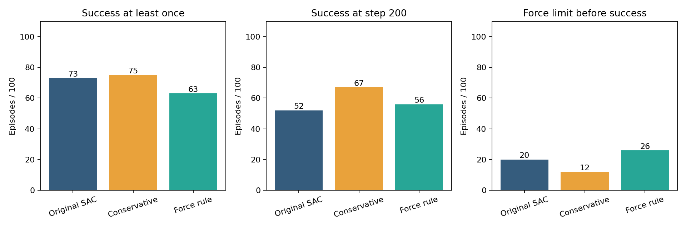
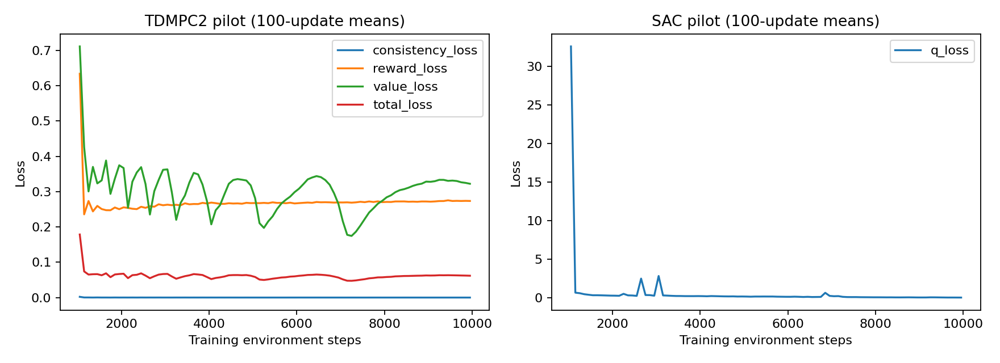

# HAB Contact-Aware World Model

面向 ManiSkill-HAB 移动机械臂抓取的接触控制与世界模型规划研究。机器人为 Fetch（移动底盘、升降躯干、机械臂和夹爪）；当前任务为 TidyHouse Pick：抓取指定物体、收回至休止姿态，并满足静止与累计接触限制。

**当前完成：接触控制配对实验、TD-MPC2 / 状态 SAC 短程训练，以及教师示范和行为克隆实验。行为克隆未通过可学习性门槛；风险预测模块尚未训练，也未得到世界模型提升 HAB 性能的研究结论。**

[计划与执行结果](refine-logs/EXPERIMENT_PLAN.md) · [执行表](refine-logs/EXPERIMENT_TRACKER.md)：**R001–R003 已完成**。20/20 教师接口配对通过，采集 100 次示范，用 53 条成功拟合轨迹完成 5,000 次 BC 更新。学生在 20 个留出起点上曾抓取 **4/20**、曾完整成功 **3/20**、结束完整成功 **1/20**。未达到预定门槛（曾抓取≥10/20 且曾完整成功≥5/20），R004/R005 保持 GATED。下一步先诊断状态输入 BC 的闭环失败。

- [行为克隆报告](reports/bc_v1_2/报告.md) · [观测与静止判据诊断](reports/bc_v1_2/观测与静止判据诊断.md)
- [本轮完整数据、所有检查点和失败记录](https://github.com/Pendragon08/hab-contact-aware-world-model/releases/tag/v0.3.0-bc-pilot) · [教师—学生 Demo](https://github.com/Pendragon08/hab-contact-aware-world-model/releases/download/v0.3.0-bc-pilot/teacher_student_demo.mp4)
- 本地恢复数据后打开 `行为克隆实验汇总.html`，可播放全部 20 对同起点视频。
- [固定起点学习协议](docs/BC_FIXED_SPAWN_EXECUTION.md) · [评估恢复协议](docs/BC_EVALUATION_RECOVERY.md) · [入口与日志异常记录](reports/BC入口诊断.md)

这是 45 维状态行为克隆的开发实验。教师的留出曾成功成绩为 17/20，使用深度历史输入；两者并非匹配观测的算法比较。本轮仍未证明世界模型或风险规划有效。

公开数据中每个训练任务有 100 个预生成起点。本轮在采集前明确分为 80 个拟合、20 个开发留出起点，避免只换随机种子却重复抽到相同起点。仅拟合部分的结束成功示范用于 5,000 次 BC 更新，留出起点不参与训练与归一化。使用 GPU1，GPU0 保留给其他人。

- [接触控制实验报告](reports/contact_v1/报告.md) · [逐回合结果](reports/contact_v1/episodes.csv)
- [状态训练报告](reports/state_pilot/报告.md) · [算法与实验方案](docs/实验方案.md)
- [数据下载与演示使用指南](docs/数据与演示使用指南.md) · [逐项验证条件诊断](reports/state_pilot/验证条件诊断.md)
- [完整原始数据、检查点和视频](https://github.com/Pendragon08/hab-contact-aware-world-model/releases/tag/v0.2.0-experiments)
- [三方案同步对比 Demo](https://github.com/Pendragon08/hab-contact-aware-world-model/releases/download/v0.2.0-experiments/comparison_demo.mp4)
- [已有 100 回合基线](reports/legacy_layout100.md) · [历史数据与见证](https://github.com/Pendragon08/hab-contact-aware-world-model/releases/tag/v0.1.0-baseline)

## 接触控制结果

同一验证宏观场景中的五个家具布局，各 20 个固定新种子。每种方案均执行完整 200 步，成功判据与原始 HAB 一致。以下是开发实验，不是完整 benchmark 或独立最终测试。

|方案|曾经成功 /100|结束时成功 /100|成功前或从未成功时触力超限 /100|
|---|---:|---:|---:|
|官方 SAC|73|52|20|
|保守运动控制|75|67|12|
|接触力规则控制|63|56|26|



保守方案将运动指令平滑后缩放至 0.7；力规则根据上一步已观测到的接触量和剩余累计预算缩放运动。夹爪绝对开合命令保持原值，头部固定。力规则额外使用模拟器接触信号，属于诊断性对照。

- 保守运动控制相对 SAC：曾成功率差 +2.0 个百分点；布局内配对 bootstrap 95% 区间 [-5.0, +9.0]。
- 接触力规则控制相对 SAC：曾成功率差 -10.0 个百分点；布局内配对 bootstrap 95% 区间 [-19.0, -2.0]。

区间只描述当前布局、固定检查点和采样回合的变化；不包含独立房屋或训练种子不确定性。完成步数只在成功回合统计，不能忽略成功回合集合不同而宣称速度优势。

## 世界模型如何训练

先运行工程预检，再从训练场景采集数据。TD-MPC2 将当前状态编码为隐状态，在模型里预测候选动作的奖励和后续隐状态，使用 MPC 选择动作，只执行第一步，获得新观测后重新规划。模型训练优化隐状态一致性、奖励和价值损失，并学习策略先验。

本轮采用 5M 档 TD-MPC2；规划长度 3，512 个候选，64 个精英，24 条策略候选，6 次迭代。状态 SAC 使用相同观测和动作空间、相同交互预算，网络规模不同。

|算法|训练交互|梯度更新|验证曾经成功|验证结束成功|实际训练耗时|
|---|---:|---:|---:|---:|---:|
|tdmpc2|10,000|9,000|0/20|0/20|49.6 分钟|
|sac|10,000|9,000|0/20|0/20|32.7 分钟|



每算法前 1,000 步随机探索，之后每步一次更新，batch 128。使用完整回合回放，采样窗口不跨回合。训练使用 train，评估使用 val；验证轨迹不进入训练。模型参数真实变化、全部更新有限、检查点可读。另有 [1/2/3 步开环奖励预测诊断](reports/world_model_prediction/报告.md)，比较模型与仅由训练奖励拟合的常数参考。

本轮两种学习策略的 20 个验证回合均未出现抓住目标的信号。输入实际为 45 维，包含模拟器提供的目标物体位姿等状态，缺少完整障碍几何；不是纯视觉输入。

补充的[时间序列参考诊断](reports/world_model_prediction/时间序列参考诊断.md)显示：在相同的 3,940 个窗口上，保持上一奖励不变的参考在两种行为数据、三个步长中的 MAE 和 RMSE 均低于世界模型。优于训练均值不足以证明学到了有效动力学；本轮奖励预测主要覆盖失败轨迹，尚未证明接触变化或成功行为的预测能力。

**10,000 步仅是训练可行性与计算成本验证。损失下降不代表已学会任务，低成功率也不等于算法无效。** 后续应先建立稳定完成任务的世界模型和匹配输入基线，再训练风险预测、进行消融及独立测试。

## 快速使用

需要 Linux、可用的 NVIDIA CUDA/Vulkan 环境和已验证的 HAB 依赖。软件版本、资产下载、缓存路径及环境限制见 [复现说明](docs/复现说明.md)。新机器完整安装尚未独立复现，不能只凭 import 成功判断环境可运行。

```bash
# 克隆私有仓库前须登录自己的 GitHub 账户
gh repo clone Pendragon08/hab-contact-aware-world-model
cd hab-contact-aware-world-model

# 设置 local-settings.sh，指向自己的 HAB_DEP_ROOT 和 HAB_PYTHON 后：
bash scripts/local_server_entry.sh witness
bash scripts/local_server_entry.sh run all
bash scripts/run_state.sh witness
bash scripts/run_state.sh pilot
```

入口拒绝覆盖已有输出。复现应使用新工作目录，保留失败尝试与旧结果。只克隆 Git 不会下载 Release 中的大文件。

## 数据、视频与完整性

Git 保存全部项目代码、固定配置、测试、报告、汇总表和图。GitHub Releases 保存本项目生成的全部原始轨迹、初始快照、深度观测、检查点、运行日志和视频，并附逐文件与压缩分片 SHA256。上游场景库和官方权重通过固定版本下载脚本获取，保留其原许可和来源，不将 Python 环境/缓存重新打包为实验数据。

下载数据至 `release/` 后，对每个 `<bundle>.release.json` 运行：

```bash
python scripts/restore_artifacts.py --inventory release/<bundle>.release.json --root .
```

工具先校验分片、合并压缩包、阻止越界解压，再逐文件校验；已有不同内容的文件不会被覆盖。解压后打开根目录 `接触控制对比汇总.html` 可以浏览 100 组对比视频。完整回合均为 201 帧、20fps，示例拼接不改变播放速度。

完整性证据：

- [控制入口独立验证](reports/入口验证.md)：5 个布局重复 SAC 轨迹与观测误差为 0。
- [状态训练入口独立验证](reports/状态训练入口验证.md)：真实更新、检查点及视频核验。
- [300 回合审计](reports/contact_v1/audit.json)与[保存观测重建 SAC 输出审计](reports/contact_v1/observation_replay_audit.json)。
- [状态训练逐回合与更新审计](reports/state_pilot/audit.json)。
- [全新 GitHub 克隆与归档恢复验证](reports/fresh_clone_audit.json)：63 个重叠文件、53 份源码，以及运行记录归档的 95 个文件均通过检查。

当前只验证重新初始化后的配对一致性。关节增量控制器导出的附加状态为空，尚未验证任意中途模拟器/控制器/RNG/观测堆叠恢复，不能直接用于反事实分支标签。

## 计算资源与边界

本轮训练与评估均绑定 GPU1（RTX A6000 48GB），未在 GPU0 启动训练或评估任务。无需 LLM API。部分任务共享 GPU1，报告中的耗时是实际运行条件下的测量，不是独占硬件吞吐；PyTorch 分配显存不包含物理模拟器、渲染和 CUDA 上下文。

[整卡资源采样](reports/resources.json)记录 GPU1 峰值占用 8,989 MiB；GPU0 最低可用 41,817 MiB，满足预留至少 12 GiB 的要求。整卡数值包含当时其他进程，5 秒间隔采样不保证捕获瞬时峰值。

原有基线 66/100 曾成功、52/100 结束成功，两者相差的 14 回合最后仍有抓取信号，不能称为 14 次掉落。新实验使用独立种子，不能把两轮数据混为同一配对对照。

当前演示覆盖抓取技能；搬运、放置、技能交接和完整导航属于后续扩展。

v0.2 归档共 3,113 个文件，已在本地逐文件恢复校验，见 [传输审计](reports/local_transfer_audit.json)。实验 Release 附件的 GitHub 校验记录见 [发布审计](reports/github_v0.2.0-experiments_audit.json)。


v0.3 行为克隆归档共 1625 个文件，压缩包 707.6 MiB；[本地逐文件恢复审计](reports/bc_local_transfer_audit.json)、[全新 GitHub 克隆重叠文件校验](reports/bc_fresh_clone_audit.json)与[GitHub 发布审计](reports/github_v0.3.0-bc-pilot_audit.json)提供完整性记录。[本轮资源采样](reports/bc_resources.json)：GPU1 整卡最高 5152 MiB，GPU0 最低空闲 45791 MiB；包含当时所有进程，5 秒采样不能保证捕获瞬时峰值。

## 代码、数据和论文来源

- [ManiSkill-HAB，ICLR 2025](https://github.com/arth-shukla/mshab) · [任务与数据](https://arth-shukla.github.io/mshab/) · [官方 SAC 权重](https://huggingface.co/arth-shukla/mshab_checkpoints)
- [TD-MPC2，ICLR 2024](https://www.tdmpc2.com/) · [原始代码](https://github.com/nicklashansen/tdmpc2)
- [ManiSkill](https://github.com/haosulab/ManiSkill) · [算法源码版本与许可](vendor_tdmpc2/PROVENANCE.md)
- [七篇相关顶会论文的五项解读：问题、创新、方法、评估和局限](docs/ManiSkill相关论文.md)

## 目录

```text
scripts/           实验、训练、报告、归档与验证入口
configs/           固定协议、种子和源码版本
tests/             控制语义、回放边界、归档完整性测试
vendor_tdmpc2/     保留许可的固定版本算法模块
docs/              中文方案、复现说明和文献
reports/           已完成结果、图表、指标和审计
history/           原有实验的历史源码与修复记录
artifacts/         下载 Release 后的全部原始数据（不进入 Git 历史）
```
