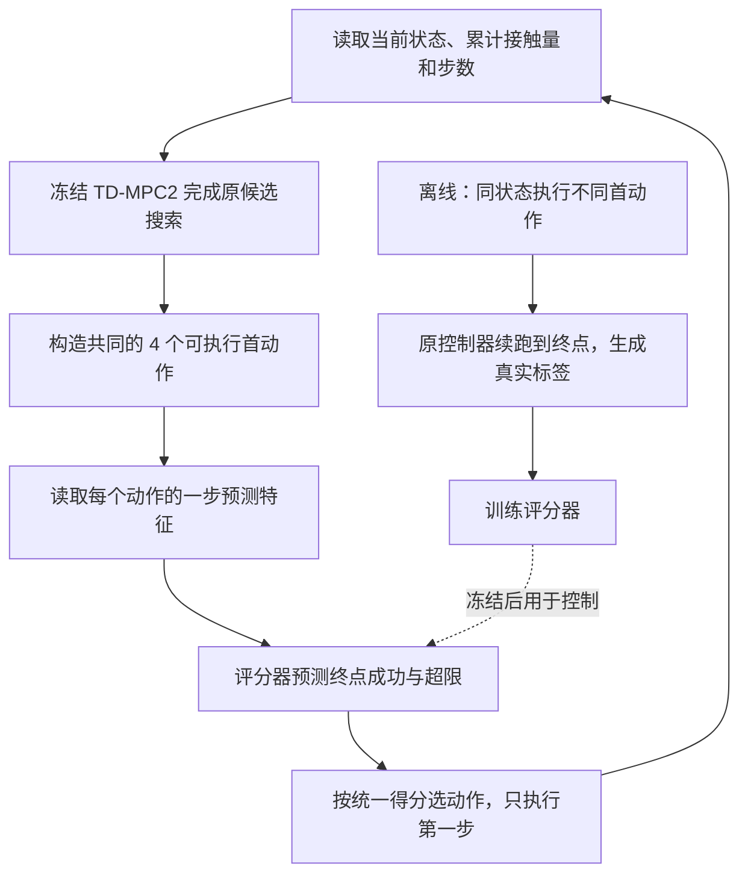

# 下一阶段研究方案：世界模型动作后果排序

整理日期：2026-09-10。本文是**待验证研究方案**，不是已完成实验报告。本次整理合并了原方案及两次文献补充，保留 E0/E1/E2 门槛、候选构造、数据划分和对照要求；不启动训练、不修改既有实验。

## 阅读导航

- [1. 一页了解课题](#overview)：研究什么、为什么做、先交付什么。
- [2. 研究问题与文献依据](#background)：已有方法解决了什么，剩下什么值得检验。
- [3. 算法设计](#method)：机器人怎样选择动作，新增模块是什么。
- [4. 数据与训练](#training)：真实标签怎么来，评分器怎么学。
- [5. 实验路线与对照](#experiments)：E0 → E1 → E2，以及共同 benchmark 的选择。
- [6. 指标与判断标准](#evaluation)：怎样判断有效，什么情况下停止。
- [7. 算力与时间预算](#budget)：先导实验与完整研究分别需要多少资源。
- [8. Codex 实施清单](#execution)：按什么顺序实现，交付哪些文件。
- [9. 局限与论文定位](#limits)：能主张什么、不能主张什么。
- [附录：文献与资源入口](#references)：详细核验报告及代码、数据来源。

<a id="overview"></a>
## 1. 一页了解课题

**建议题目：面向接触受限机器人操作的世界模型动作后果排序。**

机器人在执行动作前，TD-MPC2 会给多个动作方案估计收益。本研究要检验：在同样的候选动作中，利用真实仿真结果训练一个小型评分器，能否选出更容易在回合结束时完成任务的动作。

| 项目 | 本方案的明确范围 |
|---|---|
| 核心问题 | **同状态、同候选的真实分支监督，能否让冻结世界模型的动作选择更可靠？** |
| 基础方法 | 已训练 TD-MPC2；冻结编码器、动力学、奖励、价值和策略先验 |
| 新增部分 | 首动作后果评分器：预测终点成功与接触超限，重排共同的 4 个首动作 |
| 主应用 | ManiSkill-HAB 的 Fetch 抓取子任务：抓取、回到休止姿态、满足静止与累计接触条件 |
| 机制验证 | Meta-World V2；只使用原生成功目标，先验证动作排序是否值得研究 |
| 可选扩展 | DMC 共同任务上的强算法对照；不与抓取应用成绩混算 |
| 当前性质 | 研究假设。已有基线结果不等于该评分器已经有效 |
| 第一批交付 | 基线失败条件分解、同状态候选比较、重放核验和比较视频 |

研究分成三个递进问题：**候选中有没有更好的动作 → 能否识别它 → 连续使用后是否真的提高任务完成率。** 对应 E0、E1、E2，前一阶段未通过就不扩大后一阶段。

当前已有的是 Meta-World V2 的缩减预算原方法复现，以及 HAB 历史实验与迁移基线的阶段材料。HAB 新基线的最新状态须在实施前读取完成记录和轨迹；本文不使用“仍在运行”等描述代替实时核验。已有结果入口见 [实验与报告索引](../docs/实验与报告索引.md)。

**给老师解释的例子——以下数字仅是假设：**机器人刚抓住物体，累计接触量为 4300，阈值为 5000。原规划给快速收回动作 A 更高回报；评分器估计 A 的成功分数为 0.20、超限分数为 0.75，缓和收回动作 B 分别为 0.70、0.10。若权重 λ=1，则 A 得分 −0.55、B 得分 0.60，因此改选 B。是否真的成功，仍要执行到第 200 步验证。如果普通减速或普通价值网络同样有效，就不能归功于世界模型预测特征。

<a id="background"></a>
## 2. 研究问题与文献依据

### 2.1 三个需要验证的问题

| 问题 | 为什么值得研究 | 本方案如何检验 | 什么结果会否定这一方向 |
|---|---|---|---|
| 平均预测误差较小，但关键动作排序仍可能错误 | 普通时间步主导奖励 MAE，不能直接说明关键决策正确 | 同一状态真实执行多个首动作，比较终点结果与原评分 | 候选结果基本相同，或原 MPC 已选到最好动作 |
| 累计接触限制可能提前失去，最终无法完成任务 | 已累计的接触量不能靠最后停住消除；单纯减速也可能影响完成 | 同时监督未来超限与末步成功，以已有累计量作为上下文 | 力规则或同数据普通 critic 同样好，无法支持预测表示的增益 |
| 标签生成时的后续行为与部署行为不同 | 一次换动作后由原控制器续跑，不等于之后每一步都换动作 | 比较“单次介入后原控制器续跑”和“每一步重排” | 离线排序或单次介入有效，连续介入反而下降 |

必须区分证据层次：文献已经讨论模型偏差与预测/决策差距；旧 HAB 失败轨迹只能提供研究线索；新基线的主要错误类型仍需逐回合核验。不能从一个失败视频推断所有失败都来自排序错误，也不能把成功后失效全部称为掉落。

### 2.2 哪些方法被借鉴，哪些只是相关工作

以下沿用既有文献核验记录，详细的问题、创新、方法、指标和局限见附录链接。**正式论文与预印本分开记录；本次编辑没有重新检索或更改录用状态。**

| 文献 | 与本方案的关系 | 必须保留的区别与局限 |
|---|---|---|
| [TD-MPC2，ICLR 2024](https://arxiv.org/abs/2310.16828) | 提供冻结基础模型、策略先验与 MPC | 附录 J 已有 Q 统计惩罚；简单增加 Q 方差惩罚不是新概念 |
| [ContactGuard，2026 预印本](https://arxiv.org/html/2608.13438v1) | 借鉴冻结世界模型与轻量失败读出结构，设置预测表示消融 | 已研究同观测替换动作，并提出重规划方向；不能把“报警后改选动作”直接称为创新；不复现其完整视觉架构 |
| [Foresight，2026 预印本](https://arxiv.org/abs/2606.23085) | 借鉴终局成败标签监督 | 本方案不采用其时序检测器与 functional conformal 校准，不继承其保证 |
| [V-GPS，CoRL 2024](https://proceedings.mlr.press/v270/nakamoto25a.html) | 候选动作价值重排的直接近邻 | 新增评分器可能只是辅助 critic，必须与同数据状态—动作网络比较 |
| [WM-VAE，IROS 2025](https://arxiv.org/abs/2508.06096)；[UNISafe，CoRL 2025](https://proceedings.mlr.press/v305/seo25a.html) | 新颖性惩罚、不确定性安全过滤的相关方法 | 新颖性或 Q 分歧不是失败概率；本方案没有安全后备控制，不能继承安全保证 |
| [Sparse Imagination，ICLR 2026](https://proceedings.iclr.cc/paper_files/paper/2026/hash/a750d52284ff70c6d6bab8072c392d74-Abstract-Conference.html) | 规划计算成本的正式近邻 | 状态 MLP 没有其视觉 token 结构，首版不移植；选 4 个动作不等于稀疏注意力 |
| [FAWAM，2026 预印本](https://arxiv.org/html/2606.08555v2)；[ContactWorld，2026 预印本](https://arxiv.org/abs/2606.13877v2) | 接触预测、反馈及视触表示的近邻 | HAB 聚合接触量不是六轴腕力或触觉；力残差纠正与时序/视触扩展仅列为后续备选 |

首版准确定位为：**受 ContactGuard 与 Foresight 启发，在 TD-MPC2 状态输入上检验首动作真实分支监督及预测特征的作用。** 不能写为完整复现这两篇，也不能声称首次使用世界模型预测失败。若要求所有直接方法来源均为正式顶会或一区期刊，这两篇预印本尚不满足该条件。

### 2.3 五篇 TD-MPC2 后续工作带来的约束

| 文献 | 已有方法重点与局限（沿用全文核验） | 对本课题的影响 |
|---|---|---|
| [BMPC，ICLR 2025](https://arxiv.org/abs/2503.18871) | 通过 MPC 行为监督与重分析改善先验/价值；仍有长时域预测和重分析成本，多任务及离线验证有限 | 属于强基线候选。若候选都不好，应先研究先验与覆盖，排序器不能创造好动作 |
| [TD-M(PC)²，L4DC 2026](https://proceedings.mlr.press/v331/lin26a.html) | 研究策略与规划分布错配；以单任务状态 RL 为主，视觉、多任务及部署效率待扩展 | 分布失配不是新发现；分支标签不会自动解决其 TD 价值学习问题 |
| [BOOM，NeurIPS 2025](https://arxiv.org/abs/2511.00423) | 行为对齐；依赖较准确动力学，长 rollout、分布偏移及规划成本仍有限制 | 行为对齐是另一种解释；冻结评分器不等于改善动力学训练或降低全部在线成本 |
| [MRS.Q，ICML 2026](https://arxiv.org/html/2601.21306v2) | 保守价值机制；10 个价值网络与 MPC 有成本，稠密奖励且不早停时增益较小，仍是短时域控制 | 必须考虑合理的保守 Q 对照；对 Q 集成取最小值不是研究空白 |
| [Dream-MPC，ICML 2026](https://arxiv.org/html/2605.04568v1) | 动作梯度优化与复用；依赖高质量先验、固定优化参数，主要单任务，TD-MPC2 基座上未稳定优于 MPPI | 比较时注明 TD-MPC2/BMPC 基座及训练期是否替换规划器；不能把弱先验结果等同其主结果 |

这五篇没有直接替代本方案的验证工作，但“没有同名实验”也不能证明新颖性。真正待检验的是：在**固定模型、信息、候选和标签预算**下，相对终局监督与动力学特征变换是否带来额外收益。

<a id="method"></a>
## 3. 算法设计：冻结基础模型，重排首动作

### 3.1 在线控制流程



离线分支只用于训练和分析。实际控制时不允许查询候选的真实未来结果。

### 3.2 固定共同候选，先隔离“评分”的作用

原搜索保持 **512 候选、24 策略候选、64 精英、3 步时域、6 轮搜索**。搜索结束后构成 4 个首动作：

1. 原版实际抽中的动作。
2. 原始规划分数 G 最高的动作。
3. 按冻结规则抽取的另一精英动作。
4. 按冻结规则抽取的另一非精英动作。

按首动作最大坐标差 `1e-6` 去重，重复时按固定候选序号补足，记录缺额。所有重排对照使用同一集合；评分器不反馈进原来的 6 轮搜索。训练也采这 4 个分支，不把 4 动作监督默认推广成可选择全部 512 个候选。

必须保留两种参考：**原版抽样**与**同集合 G-argmax**。后者用于排除去随机化或改变可执行动作集合带来的收益。扩展到 16/64 个可执行动作属于独立搜索量实验，需同步计入数据与计算预算。

### 3.3 输入、输出与选择规则

| 符号 | 含义 |
|---|---|
| `s, a` | 当前状态与某个候选首动作 |
| `z=e(s)` | 冻结编码器的当前表示 |
| `z'=f(z,a)` | 冻结动力学的一步预测表示，优先复用搜索缓存 |
| `C, t` | 当前累计接触量与控制步数 |
| `pS, pV, pO` | 终点成功、未来超限、其他失败的预测分数 |

HAB 评分器输入为 `[z, a, z', C/5000, t/200]`，使用两个 256 宽隐藏层的 MLP，预计不足 50 万参数，以实现统计为准。第二、三步预测不进入首版：这些预测对应的候选尾部动作不会实际执行。若一步预测不能复用缓存，额外调用必须计入时延与模型调用量。

在核验固定 Pick 回合中“累计超限与最终成功不可能同时发生”后，使用三分类 softmax：S/V/O 互斥且概率和为 1。每个分数都对应**执行此首动作后，由冻结原控制器 π₀ 续跑到终点**的结果，而非动作本身永恒不变的失败概率。

```text
动作得分：U = pS − λ · pV
动作选择：取 U 最大者；接近同分时按原始 G 排序
```

λ 只在开发集从 `{0, 0.25, 0.5, 1}` 选择并冻结。全部候选评分很差时仍按规则选择并统计，不能以停止动作代替任务成功。该分数不提供安全保证。

HAB 当前 44 维输入已有瞬时与累计接触量；`1−C/5000` 只是等价表示，不能声称新增传感信息。时间 t 是新增上下文，所有学习型对照必须同样提供，原版仅作参考。C 是逐步累加的非负力范数，在固定 200 步和控制频率下使用阈值 5000；它不是时间积分意义的冲量，也不是损伤指标。

**Meta-World 版本**仅预测原生终点成功并按 pS 排序，不人为引入“官方接触安全”标签。它验证通用排序机制，不能直接证明 HAB 累计预算机制有效。

<a id="training"></a>
## 4. 数据与训练：首动作干预，固定后续控制

### 4.1 一条监督样本如何产生

锚点是一个回合中的同一实际仿真状态。每个锚点先完成原 MPC 搜索、尚未执行动作，再分别执行以下过程：

```text
恢复锚点 → 强制执行候选首动作 aₖ → π₀ 在新状态重新规划并续跑到终点
         → 保存终点成功 yS、未来超限 yV、剩余回报和逐步事件
```

四条分支共同构成该锚点的候选比较。真值来自真实仿真执行，不能把世界模型预测当标签，也不能把未执行的教师建议当动力学转移。公开演示通常没有这些替代动作后果，额外分支交互必须收费、计步并归档。

### 4.2 恢复与标签审计先于采集

- 优先采用“重置 + 真实前缀重放”；只有快照恢复验证通过才使用快照。
- 每个锚点先用相同原动作续跑两次，检查可重复性。若接触微差改变标签，需要重复分支估计，不能伪称确定性真值。
- 核验物理状态、控制器目标、累计量、步数、任务目标、环境/NumPy/Torch 随机状态、MPC 暖启动缓存及延迟队列。
- 保存并恢复**搜索后的**随机状态与缓存，再强制不同首动作；不能把某候选未执行的尾部写进其独有缓存。
- HAB `evaluate()` 会累加接触量，审计只读取已有 `step` 的返回信息，不额外调用它。既有 BC 重放验证不能替代本次 MPC 验证。
- 固定 Pick 中核验 S/V/O 互斥；若以后跨子任务重置累计量或恢复预算，须重新定义标签。

候选清单、控制器版本、随机数计划、恢复误差、前缀与续跑步数全部进入 manifest。标签及事件标志只作离线监督/评估，不作部署输入。

### 4.3 训练目标与参数选择

冻结 TD-MPC2，仅训练评分器：

```text
L = 分类交叉熵 CE(S/V/O) + β · 同锚点配对排序损失 Lpair
```

Lpair 仅比较同锚点真实结果不同的候选，按 `yS−λ·yV` 排序，平局不造标签；采用分数差 `Uᵢ−Uⱼ` 的 logistic 损失。温度固定或仅在开发集选择。β 从 `{0, 0.1, 1}` 选取，与 λ 联合最多 12 组，各学习对照给予相同调参预算。

保留自然类别比例，或记录重采样概率；重采样后未经校正输出不能解释为部署概率。开发和测试按自然分布采样。首版不训练校准器，只报告描述性 Brier 与可靠性结果。

分支标签取决于 π₀。部署时每一步重排会改变后续分布，因此必须区分离线排序、单次干预和完整闭环成绩；首版不自动补采或自训练。若出现明显失配，作为下一版本单独立项和计费。

<a id="experiments"></a>
## 5. 实验路线：E0 → E1 → E2

### 5.1 三阶段协议

| 阶段 | 要回答的问题 | 数据与执行 | 进入下一阶段的要求 |
|---|---|---|---|
| **E0：改善空间** | 同样 4 个动作中，是否存在原规划漏选的更好动作？ | 先 Meta-World 40 锚点 × 4 分支；根据 HAB 基线诊断再做 HAB 40 × 4。均来自训练/开发范围，不使用未来锁定测试 | 40 个锚点中至少 8 个终点结果有差异，至少 4 个有替代动作优于原选择；恢复审计通过 |
| **E1：机制辨别** | 收益是否来自相对监督与一步预测表示？ | 每基础种子 400 锚点 × 4 分支：240 拟合、80 模型选择、80 锁定离线机制检查；比较下表中的对照和消融 | 先证明排序改善及其来源，再进行开发闭环；不依据锁定数据调参 |
| **E2：闭环与泛化** | 连续重排能否改善实际任务？ | 每方法先 50 个开发回合排查；正式每基础种子、每锁定域 100 完整回合，3 个独立基础种子，4 种方法 | 开发门槛通过后冻结方法、域、种子和参数，再执行锁定测试 |

E0 门槛是节省算力的工程规则，不是显著性检验或成功保证。候选都失败时应转向先验与覆盖研究，不训练一个全负类结果头。

数据按**来源回合与初始条件组整体划分**，同回合多个时间窗不能跨集合。HAB 布局按角色划分；已经反复开发使用的 5 个 val 布局不能重命名为全新最终测试。先核查未使用的官方 test；否则使用未接触过的公开布局构建并明确命名研究留出集。独立布局不足时只报告布局内测试。

### 5.2 E1 对照：每一项对应一个解释

| 对照或消融 | 要排除的解释 / 要检验的作用 |
|---|---|
| 原版抽样；同集合 G-argmax | 收益是否只是去随机化或改变候选选择方式 |
| 附录 J 式 Q 风险；现有 5 个 Q 头的保守聚合 | 收益是否可由合理的保守价值评分解释。后者只是 MRS.Q 启发的推理适配，不是其 10 网络及 TD 目标的完整复现 |
| 简单力规则 | 是否只需已有接触信息与运动控制规则 |
| 同分支标签的状态—动作 MLP；同数据剩余回报 critic | 是否只是额外数据或普通辅助价值网络有效 |
| 预测表示线性探针 | ContactGuard 启发的廉价读出是否足够；使用 z' 与共同时间/力上下文，参数量单列 |
| 完整评分器 vs 去配对损失 | 同锚点相对监督是否必要；不是完整 Foresight 对比 |
| 去 z'、打乱 z' | 一步动力学特征是否带来增益；打乱版本保持同架构 |
| 去 pV / 去预算条件 | HAB 累计接触监督和条件各有何作用，分别明确删除字段 |
| 单次锚点介入 vs 每一步介入 | 固定 π₀ 标签与连续重排部署的失配程度 |

学习型对照共享分支数据和可用标签，使用相同时间/力上下文及调参预算；刻意移除输入的消融另行标注。MLP 对照尽量将参数量匹配在 5% 内，线性探针如实报告容量差异。改变目标、Q 聚合位置或额外调用必须写明。

**离线“同候选”**指相同锚点的同一份候选清单。闭环方法进入不同状态后，只能匹配采样规则、候选数、模型调用和种子计划，不能再声称候选内容完全相同。

### 5.3 E2 正式比较与锁定域

正式先保留 4 种方法：原版、同集合 G-argmax、E1 中按开发集预定规则选出的最强匹配信息对照、完整评分器。其他方法留在机制表，不无限扩展闭环组合。

| 域 | 初步协议 | 解释范围 |
|---|---|---|
| 未见布局、正常执行 | 锁定布局和初始条件 | 布局泛化 |
| 未见执行增益 | 开发增益 1.0/0.8，测试 0.6 | 控制执行偏移，不是摩擦变化 |
| 增益与延迟组合 | 测试 0.6 + 1 步动作延迟 | 执行偏移的组合 |

只缩放运动通道，单独核验夹爪语义；冻结测试前做接口有效性检查，不能查看测试成功率选择参数。未来若改变质量或摩擦，先证明物理接口实际生效。

### 5.4 五篇后续工作的共同 benchmark 如何用

既有全文核验确认，BMPC、TD-M(PC)²、BOOM、MRS.Q、Dream-MPC 都覆盖 DMC 的 **dog-walk、dog-run、humanoid-walk、humanoid-run**。若需要统一算法比较，先选 humanoid-walk 与 dog-walk 两项，再考虑 run；它们检验一般连续控制，不能替代机械臂抓取实证。

MRS.Q 附录 C.2 已在自身 DMC 协议下比较 TD-MPC2、TD-M(PC)²、BMPC、BOOM（原记录为 1M time steps、10 训练种子）；没有找到完全相同协议下同时比较本方案所列全部五种后续方法的表格。不能直接拼接不同论文的终点分数作为自己的排名。

Dream-MPC 的 Meta-World 任务含 Shelf Place、Pick Place Wall，接近货架操作，但都不等于当前普通 Pick Place。BMPC 原论文没有 Meta-World 主实验，Dream-MPC 在该平台运行了 BMPC 基座；这两种事实需分开。其余方法迁移到 Meta-World/HAB 都需真实适配和测试。

**两层实验分别计费：**冻结检查点的 E1 仅研究推理评分；TD-M(PC)²、BMPC、BOOM、完整 MRS.Q 等算法比较需独立重训。Dream-MPC 还要注明基座，以及仅测试替换规划还是训练期也替换。优先选择与研究问题最相关的少量强对照，未运行全部方法就不宣称优于全部后续算法。

统一比较须记录环境版本、实际 `action_space.shape`、状态输入、动作重复、回合长度、终止语义、奖励、原生环境步、随机种子、更新量和 GPU 小时。不同图注的动作维数记法不一致时，以实际实现核验为准。

<a id="evaluation"></a>
## 6. 指标、有效性判断与停止条件

### 6.1 报告哪些指标

| 类别 | 指标 | 使用注意 |
|---|---|---|
| **主指标** | 原生末步成功率；HAB 原生累计接触超限率 | 满足原始全部成功条件；不截短成功回合、不改阈值 |
| 过程表现 | 曾成功率、曾成功与末步成功差值、成功后失效比例、原生回报 | 失效比例写清分母，不把全部失效称为掉落 |
| 决策机制 | 候选改善空间、候选选择 regret、配对排序正确率、Q 高估诊断 | regret 的真值目标与 λ 必须一致；平局不伪造顺序 |
| 结果预测 | Brier、类别比例、分组可靠性、失败 AUROC/AUPRC | 无正类或无负类时记为不可计算；检测变好不代表完成率提高 |
| 计算成本 | 端到端决策 p50/p95、模型调用、分支物理步、GPU 小时、显存峰值 | 单列采集、拟合、评估；包括仿真和渲染开销 |

绝对速度或稳定保持时长可以辅助诊断，不替换原版静止条件。各训练种子分别报告，再汇总均值与离散程度。配对区间或 bootstrap 按起点/回合分组，不把相邻窗口视作独立重复；3 个种子的方差估计仍有局限。

### 6.2 什么结果才支持研究贡献

| 层级 | 所需证据 | 若不成立，如何表述 |
|---|---|---|
| 1. 存在可纠正排序 | E0 中真实分支显示原选择遗漏更好动作 | 候选覆盖不足，转向先验/价值学习 |
| 2. 相对结果监督有用 | 同数据下优于普通 critic；配对损失消融支持其作用 | 若只有额外数据有用，报告数据效应 |
| 3. 世界模型特征有增量 | 同容量/信息/标签下，优于无 z'、打乱 z'；闭环也改善成功与超限权衡 | 若普通网络或线性探针同样好，降低创新主张 |

确定性冻结模型中的 `z'=f(z,a)` **不提供信息论意义的新观测信息**。要证明的是已有动力学结构作为特征变换或归纳偏置，是否改善泛化或标签效率，不能将其包装为凭空获得“未来信息”。

开发阶段可采用以下 go/no-go 目标：末步成功提高至少 10 个百分点且超限不升高；或超限相对降低至少 30%、末步成功下降不超过 5 个百分点；同时端到端 p95 额外开销不超过 15%。这些不是已获得成绩、显著性标准或投稿保证。锁定测试报告全部域，不只挑过门槛的域。

要主张数据效率，还须区分“原版 + 等量额外在线交互”和“原版 + 同分支数据 critic”，分别控制交互数量与数据内容；它们不是同一个对照。先导阶段可以不全重训，但论文作相应主张前必须完成。

<a id="budget"></a>
## 7. 算力与时间预算

硬件是两张 A6000 48GB。**执行遵守当前仓库约束：只使用 GPU1，GPU0 不占用并至少保留 12 GiB。** 原稿中“可使用 GPU0 并行”的建议与当前执行约束不一致，本版不再将其作为默认预算安排。新研究放独立目录，不修改既有运行代码或配置；现有模型检查点不能未经验证就当作可精确恢复优化器、replay 和随机状态的续训快照。

下表沿用原方案的**粗估**：HAB 约 5.8 控制步/秒，并非本次实测速率；前缀重放、恢复检查、场景初始化、共享主机负载和规划/训练差异都可能增加耗时。实施前需短测校准。

| 阶段 | 预算草案 | 估算与上限 | 交付 |
|---|---|---|---|
| E0 | 每平台 40 × 4 分支；HAB 含前缀与重放核验设 4 万物理步上限 | HAB 控制执行约 2 小时量级，另计初始化；实现/核验约 1–2 天 | 失败分解、恢复证明、候选改善空间 |
| E1 分支采集，单种子 | 400 × 4 分支；每分支前缀 + 续跑最多 200 步，约 32 万 HAB 步 | 按假设约 15 小时；重复核验另计 | 分组数据与计费 manifest |
| 评分器拟合 | <50 万参数；batch 256；Adam 1e-3；最多 50 轮，按模型选择集固定指标早停 | 首轮设 3 GPUh 上限再评估；每配置分钟至小时的估计须短测，最多 12 组及各对照单列总量 | 学习曲线与机制对照 |
| E2 正式评估 | 4 方法 × 3 种子 × 3 域 × 100 回合 × 200 步 = 72 万 HAB 步 | 按假设约 35 小时；实际推理速度另测 | 多种子结果与时延 |
| 额外基础种子 | 除现有 seed1 外，再 2 × 50 万步 | 原预算约 48 GPUh，待校准 | 重复实验基础模型 |

不同基础种子的 latent 坐标和续跑策略不同，**每个种子分别采分支并训练评分器**。不能默认共用 seed1 的评分头：3 种子 E1 约 96 万物理步，粗估约 46 小时。加新增基础种子约 48 小时、正式评估约 35 小时，主体已约 130 GPU 占用小时，尚未包含全部调参、恢复及工程开销；若做三种子的等量额外在线交互对照，再增加约 46 GPUh 量级。

以上完整预算不是首轮立即执行清单。先只做 E0；通过后再展开 E1/E2。同种子各学习对照可共享物理轨迹，额外标签、特征计算和更新须留记录。完整首轮研究安排 **1–2 周**更合理，耗时估计不是收敛承诺。

<a id="execution"></a>
## 8. 可交给 Codex 的实施清单

新目录建议为 `research/candidate_outcome/`，下列文件是拟新增交付，不代表已经实现。

| 顺序 | 工作与文件 | 验收条件 |
|---|---|---|
| 1 | 只读核查基线完成记录和轨迹，生成 `failure_audit.json` 与报告 | 逐回合分解五项条件、首次失败、是否可恢复、是否超限；不改阈值或停止规则 |
| 2 | 冻结配置、划分与信息字段清单；实现 `replay_validation.py` | 双重重放、MPC 缓存/RNG、控制器与累计量恢复核验通过 |
| 3 | 实现 `collect_branches.py`、`audit_candidates.py`，只做 E0 | 首动作干预 + π₀ 续跑；保存 4 候选、G、预测、真值与全部计步；判断门槛 |
| 4 | E0 通过后实现 `dataset.py`、`train_ranker.py` 与匹配 critic | 冻结模型训练前后哈希一致，分组无泄漏；完成 E1 对照 |
| 5 | 实现 `rerank_planner.py` | 无额外评分版本可重现原控制；完成单次/连续介入开发比较 |
| 6 | 开发结果通过后冻结 E2，再扩充基础种子、锁定评估 | 全量结果、消融、时延与证据归档；GitHub Release 上传后核验清单 |

首批演示是**同状态、不同候选的真实后果比较**：显示原 G、预测分数（仅在评分器已有后展示）、实际累计接触量、五项条件和最终结果。预先固定选例规则，保留失败案例。E0 的真实分支结果只作研究展示，不能伪装成在线部署时可获得的信息。

<a id="limits"></a>
## 9. 当前局限与论文定位

| 局限 | 后续如何处理 |
|---|---|
| 候选全部差，或一次首动作干预信号很弱 | E0 判定；考虑 BMPC 类先验/价值机制，不继续堆评分模块 |
| 44 维状态可能部分可观测，冻结表示可能缺少接触细节 | 先诊断缺失信息；时序/视触网络另立版本，不与首版混合 |
| π₀ 续跑标签与每步重排分布失配 | 单次/连续介入比较；显著失配时停止扩大，补采需另列预算 |
| 布局与训练种子有限 | 分组留出、独立种子、明确测试范围及区间限制 |
| 仿真累计量与真实传感、安全损伤存在差距 | 只讨论原生任务约束，不宣称实机安全或伤害保证 |
| 普通 critic 或线性探针可能同样有效 | 据实定位为决策监督或实验分析，重新评估世界模型创新主张 |

首版暂不叠加力预测器、残差控制、风险校准、自适应算力和历史网络。FAWAM 式纠正只有在证实力预测偏差是主要原因、传感语义及接口可用后再立项；它需要真实纠正监督，不能仅减小动作就称为方法复现。

本任务是居家整理 Fetch 抓取子技能，可类比货架取物，但没有完成工业仓储、导航—搬运—放置全链实证。不能凭单项正结果同时宣称解决长时域、分布外、部分可观测与安全控制。

**论文衔接：**此前审阅的本地 Overleaf 备份以 PushCube、一般风险校准与自适应预算为主要描述。待检查线上最新稿件后，可改为“Meta-World 机制验证 + HAB 累计接触与完整成功条件测试”，保留直接近邻及负结果边界。本次只整理方案，没有读取或覆盖线上正文。[Overleaf 项目](https://www.overleaf.com/project/6a9f75f9f4a3e478a7d4adb3)。

<a id="references"></a>
## 附录：文献核验与公开资源

正文保留决策所需内容，详细文献卡与原文定位集中在以下材料，避免继续在方案末尾追加重复综述：

- [研究方案文献对照（2024—2026）](研究方案文献对照_20260909.md)：问题、创新、方法、指标、局限及直接近邻；还包括 Conformal Risk Control、DR-FREE 和 SPOWL 等创新边界。它们不是本方案已实现模块。
- [2026 方法来源与方案对应](2026方法来源与方案对应_20260910.md)：正式/预印本状态、采用程度、线性探针及检测指标。
- [五篇后续工作共同任务与研究空白核验](五篇TD-MPC2后续工作_共同任务与研究空白核验_20260910.md)：任务依据、全文位置、代码与 Zotero 核验记录；取代原文“补充前是否覆盖”的历史对照表作为详查入口。
- [TD-MPC2 官方代码](https://github.com/nicklashansen/tdmpc2)：实现保持已验证固定版本，不更新既有运行环境。
- [ManiSkill-HAB 代码](https://github.com/arth-shukla/mshab) · [任务和数据](https://arth-shukla.github.io/mshab/)：优先复用已有资产；公开演示不等于本研究所需的同状态分支标签。
- [Meta-World 代码](https://github.com/Farama-Foundation/Metaworld)：机制试验保持已复现 V2 版本；V3 与 V2 分开报告。
- [BMPC 代码](https://github.com/wertyuilife2/bmpc) · [V-GPS 项目](https://nakamotoo.github.io/V-GPS) · [UNISafe 代码](https://github.com/CMU-IntentLab/UNISafe) · [ContactWorld 代码](https://github.com/PokuangZhou/ContactWorld)：未经本地运行验证，不写成已复现。

维护规则：新增方法归入第 2 节，算法改动归入第 3–4 节，对照与预算归入第 5–7 节；实际结果写到对应实验报告并在第 1 节链接。保留“方案”和“实测结果”的区别。
