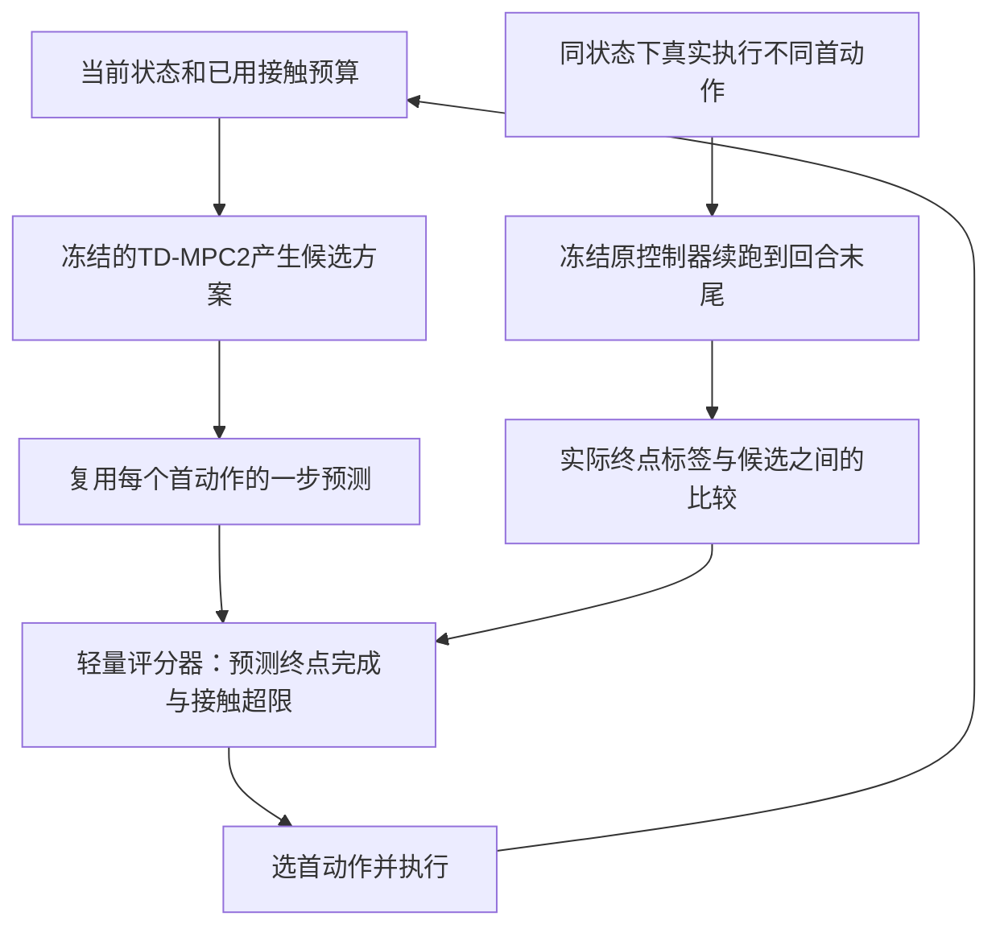

# 下一阶段具体研究方案：世界模型的动作后果排序

日期：2026-09-09。状态：拟实施的研究假设；未新增训练，未取得创新方法实验结果。

## Problem Anchor
在已有 TD-MPC2 与公开机器人仿真资源上，研究相同观测、数据及规划预算下，如何减少动作评分与真实执行后果不一致造成的抓取失败；重点检验 ManiSkill-HAB 的累计接触限制与末步任务完成，并用 Meta-World 进行低成本机制验证。使用两张 A6000 48GB，GPU0 至少预留12GiB，不更改正在运行的基线，不把未经验证的假设写成创新结论。

## 1. 建议课题与核心判断

建议题目：**面向接触受限机器人操作的世界模型动作后果排序**。通俗目标是：机器人在下手前，不只判断哪个动作奖励高，还要判断哪个动作更可能让整次任务最终完成。

将问题收敛为一条主线：**同状态、同候选的真实分支监督，能否让冻结世界模型的动作选择更可靠？** 累计接触约束和末步成功是HAB的任务结构，而不是两个再独立堆叠的大模块。跨布局/动作执行变化是测试条件，不预先承诺解决所有分布外情况。校准和自适应算力暂作未来方向。

局限分三层：①现有文献已经承认模型偏差和预测/决策差距；②旧HAB试验出现短暂成功后丢失与接触超限，只能提供研究线索；③新HAB原方法基线仍在运行，尚未证实它的主要错误类型。先检验③，再决定是否扩大该方案。

## 2. 与现有论文的关系

TD-MPC2附录J已有Q统计惩罚，WM-VAE已有新颖性规划，UNISafe已有不确定性安全过滤，V-GPS已有候选价值重排。ContactGuard甚至已比较同一观测下更换动作，作者把中止后重规划列为未来方向；因此同状态或“报警后再规划”单独都不新。FAWAM已做力预测+反馈，ContactWorld研究视触表示。

本方案仍有被视为普通辅助critic的风险。拟检验的差异限定为：**把监督目标对齐MPC真正执行的第一动作，用同状态分支产生相对结果，分别检验未来latent和配对监督的作用，在固定数据、候选、信息与时延下测试末步完成。** 不宣称首次或论文贡献已成立。论文五项对照与来源见 [研究方案文献对照_20260909.md](hab-contact-aware-world-model/refine-logs/研究方案文献对照_20260909.md)。

## 3. 三个具体难题与可检验机制

| 难题 | 为什么不能用简单补丁解决 | 本方案中的处理 | 推翻假设的证据 |
|---|---|---|---|
| 模型平均误差小，但关键动作排序错 | 平均奖励MAE会被普通时间步主导；Q分歧也不是失败概率 | 同状态下真实执行多个首动作，直接学习哪些选择改善最终结果 | 候选真实结果基本一样，或原MPC已选最优 |
| 早期接触累计超限，使后面动作无法挽回资格 | 到最后才停下无法减少已累计量；单纯减速会损害任务完成 | 显式监督候选首动作后的未来超限与末步完成，并用剩余累计量作已有状态上下文 | 力规则或普通监督critic在同数据下同样好；不能称世界模型创新 |
| 训练见到的行为与规划实际选择的行为不同 | 只给整条成功轨迹标签，不能知道“此时换个动作”是否有用 | 每个锚点对多个首动作干预，后续固定相同策略；闭环另外检验策略改变后的有效性 | 离线排序提升但闭环无收益，说明continuation或分布失配仍未解决 |

原生累计接触量C是非负力范数的逐步累加，固定200步、固定控制频率下用阈值5000判断。它不是以时间积分定义的冲量，更不是已证实的损伤指标。当前44维输入已有瞬时与累计力，不能把再次提供C声称为新传感信息。

## 4. 算法：冻结TD-MPC2，只增加首动作后果评分器

原版512候选、24策略候选、64精英、3步时域、6轮搜索不变。第一版在搜索后形成**4个可执行首动作的共同集合**：原版实际抽中的动作、原G最高的动作、按冻结规则抽取的另一精英动作、另一非精英动作。首动作按最大坐标差1e-6去重，重复时按固定候选序号补足，并保存缺额情况。所有重排对照使用这同一集合；不把评分器反馈进6轮搜索。训练也采这4条首动作分支，避免只监督4个动作却默认部署可任意选择512个未覆盖动作。

原版抽样作为参考保留；**在相同4动作集合直接按原G取argmax**是必做对照，用来排除去随机化或扩大可执行动作集合带来的收益。原G最高动作已在集合内。未来若扩大到16/64个可执行候选，属于单独的搜索量实验，必须同步扩大数据与计费。

快照在原MPC完成本次搜索、尚未执行动作时建立；恢复相同的搜索后RNG与暖启动缓存，再强制不同首动作。之后pi0在真实分支状态上重新规划；不把候选未执行尾部写进某条分支的独有缓存。

设首动作为a，当前状态为s，冻结编码器得到z，已缓存的一步预测为z'=f(z,a)。新网络输入为 `[z, a, z', C/5000, t/200]`。预测第二、三步的latent不输入首版评分器，因为它们对应的候选后续动作不会实际执行。可从原搜索缓存取z'；若实现需额外计算，逐项计入模型调用和时延。

新增网络为两层256宽MLP，预计不足50万参数，实际参数量由实现记录。核验固定Pick协议中“曾经超限与最终成功不可能同时发生”后，使用一个三分类softmax输出：最终成功S、未来超限V、其他失败O，概率和为1。它仍是同一个后果评分器，不将分类结构当成新的论文贡献。pS和pV分别对应前两类：

- pS：执行该首动作后，按冻结原控制器继续到回合终点，最终五条件成功的预测分数。
- pV：同一续跑规则下，未来累计接触量超限的预测分数。

`b=1-C/5000` 仅是已有累计量的等价表示。剩余时间/当前步t是额外上下文，必须在所有学习型对照中同样提供；原版不含t，原版比较仅为参考，真正的机制结论依赖匹配信息的对照。

对每条候选计算 `U=pS-lambda*pV`，选择最高U的首动作；lambda仅在开发集从 `{0,0.25,0.5,1}` 选一次，冻结后不按测试组调整。接近同分时回到原G排序。没有通过某个阈值就“保证安全”的说法。若全体候选预测很差，也不能停住不动假装任务成功：仍按固定规则选动作，并统计这类回合。

Meta-World无同样原生累计力指标，因此使用pS版本作为通用动作排序机制检查；不把自造力阈值当作Meta-World官方成功标准，也不把它作为HAB预算机制的直接证明。

该图中的真实分支用于离线采集监督，部署时不允许查询候选的未来真实结果。HAB这里是居家整理的Fetch抓取子任务，具有货架取物的应用类比，但当前并非工业仓库或完整搬运链的实证。

## 5. 数据与训练标签：第一动作干预，随后固定续跑

一个锚点指同一回合中的同一实际仿真状态。对候选k：恢复该锚点，执行a_k的**第一步**，从下一步起使用冻结的原MPC控制器pi0直到原200步结束。记录：终点全部条件yS、未来是否超限yV、原环境剩余回报、逐步事件。候选生成、续跑控制器版本和规划随机数计划均入manifest。

这是“给定后续控制器pi0”的行动结果标签，不是动作永恒不变的失败概率。新评分器每一步介入会改变后续分布，因此离线结果与闭环结果必须分开报告。第一版不自动补采或自训练；若失配显著，回到研究决策点，单列下一版本及额外数据预算。

用恢复同一状态后的真实执行取得标签，不能用世界模型预测当真值。重放必须检查物理状态、控制器目标、累计量、步数、任务目标、环境/NumPy/Torch随机状态、MPC缓存与延迟队列。HAB `evaluate()`会累加接触量，审计时不得额外调用它；读取已有step返回的info，避免检查本身改变轨迹。

优先使用重置+真实前缀重放作为可审核方案；快照只有验证通过才用。每个锚点须先用相同原动作继续两次，检查结果可重复；若接触微差足以改变标签，需要重复分支估计而非伪称确定性真值。既往BC重放验证不能自动替代本次MPC恢复验证。

若任务会重置累计量、跨子任务重新获得接触预算，上述三类互斥关系不再默认成立，必须重新定义标签。当前只针对固定Pick回合；不在子任务之间扩展这一假设。

损失为 `L = CE(pS,pV,pO; y_class) + beta*Lpair`。Lpair只比较同一锚点中真实结果不同的候选，使用 `(yS-lambda*yV)` 的顺序；平局不造标签。配对logistic损失输入分数差U_i-U_j，可固定温度或开发集选值；分类交叉熵提供绝对结果信号，配对项是否必要由消融回答。beta从 `{0,0.1,1}` 开发选择，lambda和beta联合最多12组，各对照给相同调参预算。

拟合时保留自然类别比例或记录采样概率；若做类别重采样，不把未经校正输出解释为部署概率。验证/测试按自然分布采样，首版不拟合校准器，也不单独占用校准集；在锁定测试上只报告描述性的Brier与分组可靠性。所有事件标志只作为离线标签和评估，不作为部署特征。

## 6. 数据划分与三块实验

**E0：先证明有东西可以改（工程门槛，非论文显著性标准）。** 保留旧/新实验版本差异。先做Meta-World 40个锚点，再视HAB完成结果做HAB 40锚点，每点4个首动作（原版会选的、原G最高的、其他精英和非精英；从同次原搜索抽取并去重）。起点只来自开发/训练范围，不能使用将来锁定测试。分支中的原选择和替代选择都跑到终点。

门槛：40个锚点中至少8个存在不同终点结果，且至少4个存在替代动作优于原选择，才扩大。门槛是预先给出的节省算力规则，不是显著性或保证；未达标停止该方向的扩大试验。所有候选都差时，优先改善策略先验/覆盖，参照BMPC，不训练一个全负类风险头。

**E1：固定候选、数据和模型，辨别收益来源。** 先导数据计划为400锚点×4分支：240拟合、80模型选择、80锁定的离线机制检查。来源回合和初始条件组整体划分，一个回合多个时间窗不得跨集合；HAB场景布局按角色分组。现有5个val布局已被反复开发使用，不能重新标成全新最终测试；优先查验未用官方test，否则从尚未使用的公开布局建立明确命名的研究留出集并记录限制。若没有足够独立布局，仅报告布局内测试。

比较：原版参考、同集合原G-argmax、附录J式Q风险、简单力规则、相同分支监督的状态—动作评分器、相同分支监督的回报critic、本文评分器；消融为去配对loss、去z'、打乱z'、去pV/预算条件。所有学习型对照看到相同时间/力上下文及标签，调参预算一致。通过调整宽度将参数量尽量匹配在5%内，并报告实际参数与训练时间；打乱z'对照则保持完全相同架构。最终机制表可按结论收缩：若去z'或状态动作critic表现相同，世界模型预测表征不是必要机制。

离线“同候选”必须是真的同一锚点候选清单；闭环各方法走向不同状态后不再声称候选内容完全相同，只匹配采样规则、候选数、模型调用和种子计划。模型选项若增加Q或VAE调用，计入附加开销。

**E2：通过前两块后，才做闭环与泛化。** 第一阶段每方法先50个开发回合排查工程错误。正式计划每个基础训练种子、每个锁定域100个完整回合，3个独立基础种子。先只保留E1中最强的匹配信息对照，以及原版、同集合G-argmax、本文共4种方法，避免所有选项无限扩展。

三类锁定域：未见布局的正常执行、训练/开发范围外的执行增益、同样增益加动作延迟。初步增益设定开发1.0/0.8，测试0.6及0.6+1步延迟；只缩放运动通道，夹爪语义独立核对；明确这是控制执行偏移，不称真实摩擦变化。各域名称和种子冻结前做接口有效性检查，不查看测试成功率选参数。将来若改变摩擦/质量，必须先证实所用物理接口真的生效。

主指标：原生末步成功率、原生累计力超限率。辅助：曾成功率、两者差值、成功后失效比例（须报告分母）、候选选择regret、配对排序正确率、Brier/类别比例、p50/p95端到端决策时延、任务原生回报。辅助工程检查可报告绝对速度/稳定保持，但不替换原版静止判据。记录训练时GPU小时、分支物理步、模型调用和显存峰值。

每个训练种子分别给结果，再给种子均值/离散程度；起点配对区间或bootstrap不得把相邻时间窗当独立重复。3个种子的方差估计本身也不稳，报告这一限制。原版+额外等量在线步和原版+同分支数据critic分开回答交互数量与数据内容两类混杂；先导阶段不必立刻全部重训，但论文主张额外数据效率前必须完成。

“更好”的工程目标可预先设为：在开发集末步成功提高≥10个百分点且触力超限不升高，或超限降低≥30%且末步成功不低于对照5个百分点；同时端到端p95额外开销≤15%。这些仅是go/no-go目标，不是已获得结果，也不是论文接受标准。论文报告全量结果和区间，不靠只挑达到门槛的域作结论。

## 7. 资源、工期和停止条件

当前HAB原方法继续在GPU1完成。新研究入口放独立目录，不修改正在执行的runner/config/upstream。GPU0可用于另一路有限验证或独立种子，但持续保留至少12GiB并计入仿真分配；共享CPU/I/O可能影响双卡吞吐，不承诺两倍加速。当前检查点主要保存模型，不能未经验证声称能精确恢复优化器、replay和随机状态继续训练。

| 阶段 | 预算草案 | 预计用时（待短测校准） | 交付 |
|---|---|---|---|
| E0 | 每平台40锚点×4分支；HAB包含前缀与重放校验设4万物理步上限 | 编码/核验1–2天；HAB按现有约5.8步/s估控制执行约2小时量级，重配置需另计 | 五条件失败图、重放证明、候选改善空间 |
| E1数据 | 400×4分支，每分支前缀+续跑最多200步，约32万HAB步；另列重复校验与重配置 | 单卡按上述速度约15小时量级，并非实测承诺 | 分组数据集、标签与计费manifest |
| 评分器拟合 | <50万参数，batch256，Adam 1e-3，最多50轮，按模型选择集固定指标早停 | 预计每配置分钟到小时，首轮设3GPUh上限再评估；全部12组需单列总预算 | 学习曲线、排序与去模块对照 |
| E2正式 | 4方法×3种子×3域×100回合×200步=72万HAB评估步 | 按5.8步/s保守换算约35小时；推理实测速率可能更快 | 多种子主表、成功/超限和时延曲线 |
| 基础种子 | 现有seed1之外再2×50万步 | 约48GPUh量级，可双卡并行但须实测资源影响 | 可复核的重复实验 |

不同基础训练种子的latent坐标和续跑策略不同，**每个种子分别采集分支并训练自己的评分器**。不能默认共用seed1的数据或评分头。完整3种子E1数据约96万物理步，按上述速度约46小时，另加回放验收/恢复开销；两个新增基础种子约48小时，正式评估约35小时，再加所有小头训练、调参和额外交互对照，主体已超过130GPUh。原版+同量额外在线训练若做3种子还会增加约46GPUh量级。此为成本估算，不是新增实验已获授权启动或已完成。

同一个种子的相同物理轨迹可供其各学习型评分对照共享，但新增label、latents或优化器更新都须留记录。数据/训练/评估三项预算分别统计，不把仿真分支藏到“离线训练”中。完整首轮研究更合理的安排是**1–2周**（含实现、诊断、负结果处理）；不是“再跑一个晚上就能有论文创新”。E0没通过就停止大规模E1/E2；不要硬凑全套。

### 给老师看的例子（以下数字是假设示意，不是实验结果）

机器人刚抓住物体，累计量C=4300，距5000阈值还剩700。原模型可能给快速收回动作A更高G，但在同状态分支数据上训练的评分器估计A为pS=0.20、pV=0.75；缓和收回动作B为pS=0.70、pV=0.10。lambda=1时U_A=-0.55、U_B=0.60，因此改选B。实际能否完成，仍要执行到第200步验证。

如果简单降低动作幅度就能同样改善，或普通critic也选出B，那么结果不足以证明世界模型预测的特殊价值。这就是为什么必须保留力规则、G-argmax和同数据critic对照。

## 8. 可直接交给Codex的实施顺序

1. 只读收集HAB当前轮完成记录和轨迹，核对基线及五项条件；以每回合为单位分析首次失败、是否可恢复、是否已超限。输出failure_audit.json/报告，严禁改任务阈值或截短成功回合。
2. 新建独立实验目录 `research/candidate_outcome/`；写冻结配置、数据划分和信息字段清单。先实现 `replay_validation.py`，通过双重重放与MPC缓存/RNG恢复检查再允许分支采集。
3. 实现 `collect_branches.py` 与 `audit_candidates.py`，只做E0预算；每候选执行第一动作，再固定pi0续跑，不加载评分器。保存动作、预测、原G、完整真值和全部计费。
4. E0通过后实现 `dataset.py`、`train_ranker.py` 和信息/数据匹配的critic；冻结基础模型，校验训练前后权重哈希一致；先跑E1而不是重新训练50万步。
5. 实现 `rerank_planner.py`，保留原候选生成，复用z'；用无额外评分版验证原控制轨迹可重复，再做同起点闭环对照。
6. 开发集结果通过才冻结E2协议和最终留出数据；增加基础训练种子、做锁定测试、消融和时延对比。所有新增数据计入预算并保存GitHub Release校验清单。

首批交付应是**失败原因分解+同状态候选比较视频**，不是先写“我们提出新算法并取得显著提升”。视频同时显示原G、候选结果评分、实际累计接触、五项条件和最终结果；展示预先固定的一组起点，保留方法失败案例。

## 9. 创新主张的分级和失败后的选择

1. **第一层：机制事实。** 在相同状态/候选中，原评分存在可纠正的错误排序。只有E0数据能支持，成功视频不能替代。
2. **第二层：监督方法。** 同锚点相对后果监督在同数据下优于单纯回报critic；用去配对loss判别是否来自相对监督。若只有额外数据有效，就报告数据效应。
3. **第三层：世界模型的增量。** 加入冻结一步预测z'在同容量、同信息、同数据下优于无z'或打乱z'，且闭环改善末步完成与超限的权衡。这一层成立，才有依据将world-model后果表征写入核心贡献。

单纯加力信息、加一个分类头、使用配对分支、或将ContactGuard的中止换为重规划都不足以自动达到第三层。新颖性仍需结合直接近邻全文和实验证据判断。当前审阅结论属于研究设计意见，不是方法已有效、可投顶会或安全认证。

若E0没有可改善候选，选择**策略先验/价值学习**这一替代方向，先对照BMPC的机制改善候选覆盖。若E0可改善但评分器不泛化，先检验状态是否缺少历史/接触信息，再决定是否做时序表征；不同时加入历史网络、力模型、风险校准和算力控制四套模块。

## 10. 与论文初稿的衔接及当前局限

本地Overleaf备份仍以PushCube、一般风险校准和自适应预算作第一阶段描述。建议将第一阶段更新为Meta-World机制验证，将HAB作为累计接触与完整任务条件的主要测试；删除尚未做出的性能/概率保证措辞。相关工作保留原脉络，强化V-GPS、ContactGuard、FAWAM、ContactWorld的区别；不要为了突出创新删掉直接近邻。

网页工具本轮无法读取在线Overleaf，本文只依据本地备份；不覆盖或声称同步了线上正文。线上项目仍是 https://www.overleaf.com/project/6a9f75f9f4a3e478a7d4adb3 。

剩余限制：候选覆盖不足、首步干预信号弱、44维状态可能部分可观测、冻结表示可能丢失接触细节、续跑策略依赖、跨布局小样本、状态输入与实机传感差距、仿真累计量不等于安全损伤。这些不能用一项正结果全部解决。若普通critic同样有效，应诚实将成果定位为决策监督或实验分析，重新评估世界模型创新叙事。

## 11. 2026年方法来源补充（2026-09-10）

首版直接借鉴ContactGuard（2026）的冻结世界模型加轻量结果探针结构，以及Foresight（2026）的终局标签监督原则；两篇目前按预印本记录，尚未实现或完整复现。E1补充同分支数据的预测表示线性探针对照，保留等容量critic和去配对损失消融。Sparse Imagination（ICLR 2026）是正式近邻，但视觉token稀疏化未移植；FAWAM的力残差纠正仅为后续备选。详见[2026方法来源与方案对应](D:/具身智能/hab-contact-aware-world-model/refine-logs/2026方法来源与方案对应_20260910.md)。创新需由同状态真实动作分支和闭环结果证明，不能仅靠文献年份或叠加已有模块。