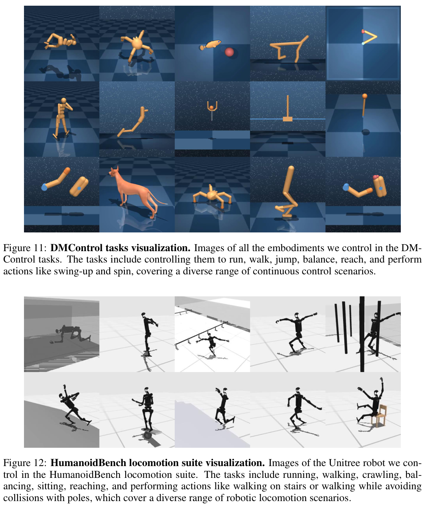
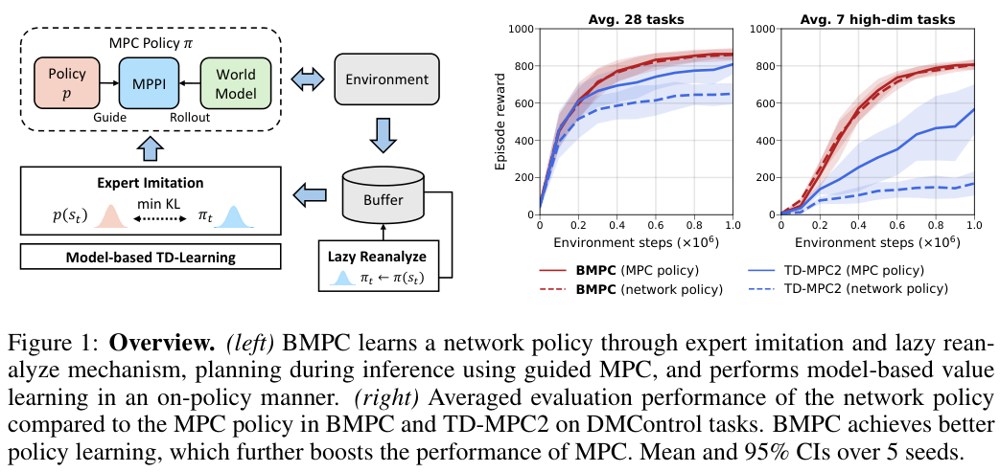
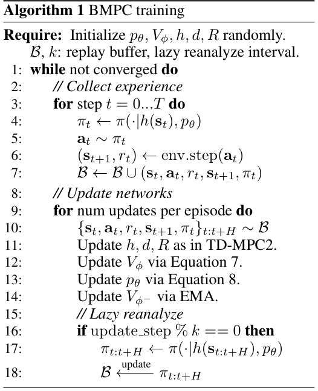
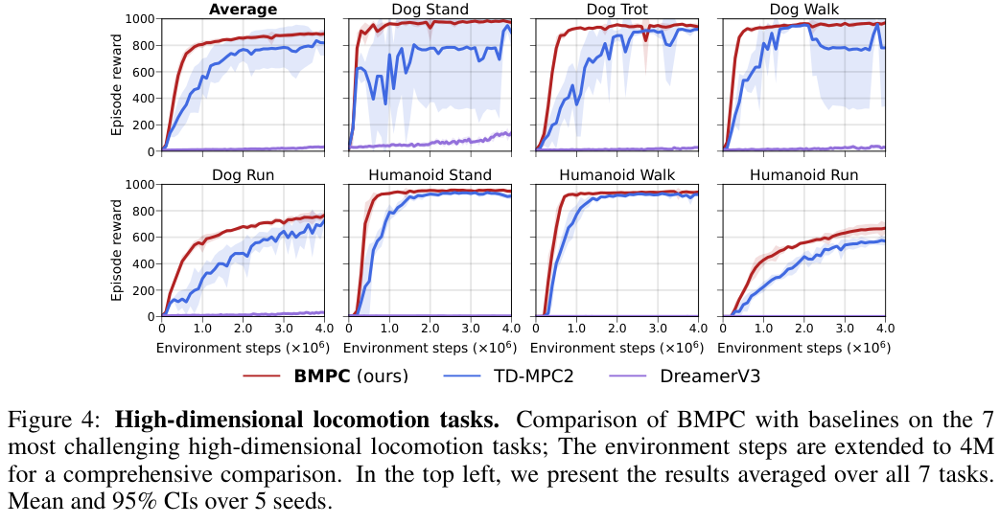
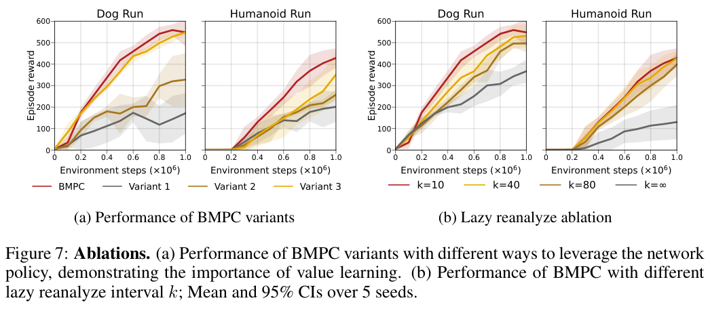

# BMPC：Bootstrapped Model Predictive Control 论文汇报

**论文：** Bootstrapped Model Predictive Control

**作者：** Yuhang Wang、Hanwei Guo、Sizhe Wang、Long Qian、Xuguang Lan；西安交通大学

**发表：** ICLR 2025 · 解读版本：arXiv:2503.18871v2，2025-04-03 · 整理：2026-09-10

**阅读顺序：** 背景 → 创新与方法 → 仿真平台与数据 → 整体算法和原图 → 网络与规划 → 局限 → 训练与测试 → 原论文结果 → 消融 → TD-MPC2 对照 → 我们的课题与复现核对。

> 💡 一句话：BMPC 让“会搜索的 MPC”指导“直接输出动作的策略网络”，再用更好的策略学习价值、辅助下一次搜索，形成相互改进的循环。它沿用 TD-MPC2 的潜在世界模型，重点改进策略学习、价值学习和专家标签更新。

本报告是论文解读及作者公开结果核对，**没有新增 BMPC 训练或仿真实验**。论文原图、作者曲线数据与我们的分析分别标注；不能将已有 Meta-World TD-MPC2 的 8/10 成绩当作 BMPC 成绩。[正式会议页](https://proceedings.iclr.cc/paper_files/paper/2025/hash/8636419dea1aa9fbd25fc4248e702da4-Abstract-Conference.html) · [论文 PDF](https://arxiv.org/pdf/2503.18871v2) · [官方代码](https://github.com/wertyuilife2/bmpc)

## 01 · 研究背景：TD-MPC2 已经有规划，为什么还需要 BMPC？

**核心问题：MPC 已经产生较好的交互经验，为什么内部策略网络仍然学不好？这个差距又怎样影响规划末端的价值估计？**

TD-MPC2 有两种产生动作的方式：策略网络 p 直接输出动作；MPC 用模型搜索后再选动作。原策略按 Q 值与熵目标学习。作者在 Dog Run、Humanoid Run 等困难任务中发现：MPC 控制可以进步，网络策略却明显落后。MPC 的终端价值又与这个较弱的策略有关，因此问题不只是“候选动作不够好”。

| 研究背景中的困难 | 通俗解释 | 论文希望解决什么 |
|---|---|---|
| 网络策略与 MPC 表现差距较大 | 机器人“认真搜索后会做”，直接反应却不会 | 让策略直接学习 MPC 搜索后的动作分布 |
| 规划依赖的价值对应较弱策略 | 短期搜索结束后，对“后面能做好多少”的估计不理想 | 让更好的策略参与价值目标构造 |
| 最新专家标签很贵 | 每次训练都对整批历史状态重新规划，会重复付出大量搜索成本 | 缓存专家分布，低频刷新后反复使用 |

论文用式(5)比较“模型估计的 MPC 序列价值”与“策略候选的平均价值”，帮助分析策略差距。**这是模型内估计差，不是模拟器提供的真实最优值，也不是校准过的失败概率。**策略性能差距和后续消融共同构成作者的机制论证，不能把任何差距都视为价值错误的数学证明。

依据：论文 §3、§4.1、图2，PDF 第3–5页。[方法原文](https://arxiv.org/html/2503.18871v2)

## 02 · 创新点 Contribution：主要贡献是哪三项？

| 贡献 | 具体做法 | 相比已有基础新增了什么 |
|---|---|---|
| **专家迭代式策略学习** | MPC 用网络策略引导搜索；网络策略模仿 MPC 的高斯动作分布 | 将 TD-MPC2 的 max-Q 策略学习改为专家模仿，使策略与规划相互促进 |
| **基于模型的策略价值学习** | 用最新模型和当前策略生成 TD 目标；默认学习 V(s) 而不是 Q(s,a) | 将策略改进与价值学习连起来，减少旧行为与当前策略不一致造成的问题 |
| **Lazy reanalyze：低频重分析** | 把专家分布存进回放，每隔若干更新只刷新一小部分，写回复用 | 在标签新鲜度和反复规划成本之间取舍 |

实验层面，作者在 42 项连续控制任务上比较样本效率、最终表现、训练稳定性及时间；默认 BMPC 约 3M 参数，TD-MPC2 对照约 5M。**潜在世界模型、MPPI、专家迭代、模仿学习和重分析都各有前序工作**；BMPC 的贡献是这里的具体组合与设计及其验证，不能把这些通用概念都说成它首次提出。

“Bootstrapped”在这里主要指**策略与规划自我促进**；TD 目标中的价值自举是相关但不同的用法，也不是统计学 bootstrap 重采样。

依据：论文摘要、§4.2、§5、图1及算法1，PDF 第1–2、5–7页。

## 03 · 方法 Method：如何对应解决三个挑战？

| 问题 | 方法 | 预期作用 | 仍然存在的边界 |
|---|---|---|---|
| 网络策略学不到 MPC 的好行为 | 以 MPC 动作分布作为监督，优化 KL 与熵项 | 直接学习搜索改善后的行为，而不只依赖 Q 梯度 | 专家由当前学得模型产生，可能出错，并非完美教师 |
| 价值学习受旧行为与弱策略影响 | 从真实状态编码出发，用当前策略在模型里生成短 TD 目标 | 价值对应当前策略；改善 MPC 的终端收益估计 | 模型误差会进入 TD 目标，长预测仍困难 |
| 每次都重新规划标签太慢 | 在 replay 中缓存分布、低频刷新并复用 | 降低监督标签的平均生成成本 | 旧标签仍有滞后；刷新不是免费计算 |
| 不同动作空间导致 KL 尺度变化 | 用 KL 的移动分位数范围归一化，配合熵正则 | 改善跨任务训练尺度与探索 | 不是收敛或全局最优保证 |

通俗理解：**MPC 是用学到的世界模型临时解题的“老师”，网络策略是快速作答的“学生”；老师也接受学生提供的候选，价值网络估计学生后面还能拿多少分。**老师和学生从训练中共同成长，不需要另请一个人工专家，也不需要 LLM API。

依据：论文式(6)–(8)、算法1；实现细节差异见第16节。

## 04 · 42 项任务：两个仿真平台分别测什么？

<div style="padding:20px;border:1px solid #cbd9ec;border-radius:10px;background:#eef4fb;text-align:center;font-size:21px;line-height:1.8"><strong>BMPC 论文主实验：42 = DMControl 28 + HumanoidBench 14</strong><br><span style="font-size:15px">这是该论文的评测集合，不能套用 TD-MPC2 的“104 项、四个平台”。</span></div>



原图来源：论文附录 D，PDF 第19页。上半是不同 DMControl 机器人，下半是 HumanoidBench 中的 Unitree 人形机器人；这是作者任务示意，不是我们生成的仿真结果。

| 平台 | 仿真与输入特征 | 论文覆盖 | 训练预算与重点 |
|---|---|---|---|
| **DMControl / DeepMind Control Suite** | MuJoCo；关节、姿态、速度等状态/本体感知输入，动作是连续控制量 | 28 项，包括平衡、摆起、到达、旋转、步行和奔跑；不计用于多任务训练的自定义扩展 | 常规曲线到 1M 环境步；7 个高维 Dog/Humanoid 任务延长至 4M；动作重复为2 |
| **HumanoidBench locomotion suite** | MuJoCo 人形机器人；高维全身状态与动作，论文描述最大动作维度61 | 14 项运动任务：Balance Hard/Simple、Crawl、Hurdle、Maze、Pole、Reach、Run、Sit Hard/Simple、Slide、Stair、Stand、Walk | 图5到 2M 环境步；动作重复为1；检验高维全身控制与复杂运动 |

7 项高维 DMC 是：**Dog Stand、Trot、Walk、Run，以及 Humanoid Stand、Walk、Run**。DMC 的 humanoid 和 HumanoidBench 的 Unitree 环境不是同一个任务。

其余 21 项 DMC 包括：Acrobot Swingup；Cartpole Balance、Balance Sparse、Swingup、Swingup Sparse；Cheetah Run；Cup Catch；Finger Spin、Turn Easy、Turn Hard；Fish Swim；Hopper Hop、Stand；Pendulum Swingup；Quadruped Run、Walk；Reacher Easy、Hard；Walker Run、Stand、Walk。完整列表见图9，PDF 第17页。

**没有主实验结论的平台：**官方仓库保留 Meta-World、ManiSkill2、MyoSuite 接口，不意味着 BMPC 原论文报告了这些平台的成绩；更不等于已经测试我们的 ManiSkill-HAB 抓取。平台支持、论文结果、我们实际运行三者需分别说明。

依据：论文 §5、图3–5及附录C/D。[DMControl 官方代码](https://github.com/google-deepmind/dm_control) · [HumanoidBench 官方代码](https://github.com/carlosferrazza/humanoid-bench)

## 05 · 数据集与公开资源：需要先下载专家示范吗？

**论文核心是单任务在线强化学习。**环境提供可交互仿真、机器人和任务；训练时自行产生带奖励的经验，同时把 MPC 分布参数存进 replay。它不要求先准备人工演示数据集。

| 资源 | 内容 | 怎样使用与解释 |
|---|---|---|
| [BMPC 代码](https://github.com/wertyuilife2/bmpc) | 网络、训练、环境适配、评估和配置 | 首先固定版本；本报告核对提交 `d5dabc6cb58d463829571548c47711dff074f5af` |
| [作者结果文件](https://github.com/wertyuilife2/bmpc/tree/d5dabc6cb58d463829571548c47711dff074f5af/results) | DMC 1M、高维 DMC 4M、HumanoidBench 2M 的曲线 JSON 和图 | 可重画作者曲线、核对量级；曲线汇总不等于逐回合原始轨迹或模型权重 |
| DMControl、HumanoidBench | 模型资产、任务接口、状态、奖励及仿真 | 在线训练数据需要运行控制器采集；不把环境本身称作专家数据集 |
| [TD-MPC2 MT30/MT80 数据](https://huggingface.co/datasets/nicklashansen/tdmpc2) | TD-MPC2 公开离线回放 | BMPC 仓库的下载脚本指向该上游数据，不能称为 BMPC 新建数据集或已完成的离线 BMPC 实验 |

作者在结论明确表示多任务与离线实验尚未开展。当前核对的 parser 也拒绝 `bmpc=true` 的多任务模式；代码中留有多任务示例或下载脚本不能代替实验支持。像素接口同样不能被解读为论文42项都是视觉输入。

依据：论文 §6–7；[数据脚本](https://github.com/wertyuilife2/bmpc/tree/d5dabc6cb58d463829571548c47711dff074f5af/datasets)、[配置解析](https://github.com/wertyuilife2/bmpc/blob/d5dabc6cb58d463829571548c47711dff074f5af/bmpc/common/parser.py)。

## 06 · 一页理解整个算法：策略、规划、价值相互改进



**论文原图1，PDF第2页。**左边是算法关系，右边是作者的平均评估曲线：实线为 MPC 控制，虚线为网络策略；红色 BMPC 的两种控制表现更接近。右图的均值与95%区间来自5个训练种子，不是5个评估回合。

```text
① 当前观察 s → 编码器 h → 潜在状态 z
② 网络策略 p 产生部分候选；MPC 在模型里搜索并优化
③ 执行 MPC 首动作 → 获得真实下一观察和奖励
④ 把真实转移 + MPC 专家动作分布存入回放
⑤ 真实转移训练模型；当前策略的模型想象训练 V
⑥ 策略 p 模仿缓存的专家分布；少量旧标签定期重新规划
⑦ 更新后的策略、模型和 V 支持下一次 MPC，重复循环
```

请分清三个“未来”：**模型预测**是规划中的估计；**仿真实际执行**提供真实训练转移；**重新分析**是在已保存的历史观察上再做模型规划，它不会得到新真实下一状态。

依据：论文图1、算法1与 §4.2。

## 07 · 五个网络模块：继承什么，改变什么？

| 模块 | 输入 → 输出 | 在 BMPC 中做什么 | 与 TD-MPC2 的关系 |
|---|---|---|---|
| 编码器 h | 观察 s → 表示 z | 把高维状态转成用于预测与决策的表示 | 沿用潜在模型基础与一致性学习 |
| 动力学 d | z、动作 a → 下一表示 | 在潜在空间推演候选及构造价值目标 | 沿用；无未来图像解码器要求 |
| 奖励模型 R | z、a → 奖励预测 | 评价短期收益，参与模型 TD 目标 | 沿用真实奖励监督 |
| **价值网络 V** | z → 当前策略未来回报 | 估计规划窗口之后的收益；默认2个集成网络 | 用 V 替代默认5头 Q；价值目标改为基于模型的当前策略 rollout |
| **策略先验 p** | z → 高斯动作分布 | 产生部分搜索候选，也可直接执行动作 | 从 max-Q 更新改为模仿 MPC 分布并保留熵项 |

MPC/MPPI 是搜索过程，**不是额外训练的第六个神经网络**。它依靠当前 h、d、R、V、p 工作。“教师”就是搜索得到的动作分布，不是另外下载的 TD-MPC2 权重、脚本专家或 LLM。

作者的默认模型约3M参数，沿用 TD-MPC2 的主要结构，价值集成由5降为2是模型较小的重要原因。相同名称不意味着两个算法的所有权重可直接互换，尤其 Q 和 V 的输入及目标不同。

依据：论文 §3、§4.2、§5配置说明和表2；[网络实现](https://github.com/wertyuilife2/bmpc/blob/d5dabc6cb58d463829571548c47711dff074f5af/bmpc/common/world_model.py)。

## 08 · 规划：世界模型怎样帮助选出动作？

BMPC 保留短时域 MPPI：从策略先验和搜索分布采样动作序列，用世界模型推演，用预测奖励与末端 V 打分，保留较好的序列更新搜索分布，只执行第一动作。

```text
序列分数 G = R(z₀,a₀) + γ R(z₁,a₁) + γ² R(z₂,a₂) + γ³ V(z₃)
其中 z₁=d(z₀,a₀)，z₂=d(z₁,a₁)，z₃=d(z₂,a₂)
```

这里展示默认 H=3 的形式。末端 V 补充搜索窗口之后的价值，因此 **H=3 不等于只考虑未来三步的全部收益**。但 V 是估计，不保证长期最优。

| 当前官方配置项 | 数值 | 含义 |
|---|---:|---|
| 规划/重规划长度 | 3 / 3 | 在线选择动作与刷新标签的短搜索长度 |
| 总候选 / 策略候选 | 512 / 24 | 24 条先验序列包含在512条之内 |
| 精英候选 | 64 | 用于更新搜索分布 |
| 搜索迭代 | 基础6轮 | 代码对动作维度 ≥20 再加2轮，所以高维任务实际可为8轮 |
| TD 目标 rollout 长度 | N=1 | 与规划长度 H=3 是两个参数 |

**教学例子：**腿部动作 A 眼前奖励高但可能导致下一状态失衡；动作 B 稍慢却让末端 V 更高，MPC 可以选择 B。这是解释搜索评分的例子，不是论文新增的“安全标签”或某个已验证动作案例。

依据：论文 §3–4、表2；[规划实现](https://github.com/wertyuilife2/bmpc/blob/d5dabc6cb58d463829571548c47711dff074f5af/bmpc/bmpc.py)。

## 09 · 局限性：论文没有解决哪些问题？

| 局限 | 原文明确说明或本报告的分析 | 对我们选题的意义 |
|---|---|---|
| 长预测仍不可靠 | **作者明确：**模型长时域能力不足，TD rollout 默认只能取1，过长会积累误差 | BMPC 改善策略与价值，不能直接视为解决长期动作后果预测 |
| 重分析有成本且标签会过时 | **原文与实现：**低频刷新而非每次重算；约10%–20%额外训练耗时，当前单线程实现 | 需报告更新时间和标签滞后，不能说专家监督免费 |
| 多任务和离线扩展未验证 | **作者明确：**作为未来方向，尚无对应实验 | MT30/MT80 下载入口不等于 BMPC 多任务复现 |
| MPC 专家依赖模型和价值质量 | **本报告分析：**错误规划也会成为模仿标签 | 没有天然安全、真实最优或无偏专家保证 |
| 主实验集中于状态输入运动控制 | **可核验范围：**42项来自DMC与HumanoidBench | 不能直接推断 HAB 接触受限抓取、视觉操作或真实机器人都有效 |
| 直接策略与 MPC 接近不代表所有任务等价 | **证据边界：**论文主要在 DMC 对比展示这一现象 | 实际部署仍需分别评估成功率、回报和延迟 |

作者还提出未来可结合专家模仿与 max-Q 梯度，或采用更强规划价值估计。这些是作者的研究方向，不能直接搬来就宣称我们首次提出。依据：论文 §6、附录 A；本报告分析项已明确标注。

## 10 · 训练：如何从随机网络逐步学会控制？



原图：论文算法1，PDF第6页。初始化 h、d、R、V、p 的随机参数，并在在线训练中反复采集和更新。代码的初始随机探索与 seed-buffer 更新属于启动阶段，不是加载外部专家权重。

### A. 用真实经验学习世界模型

采集并保存观察、真实动作、奖励、下一观察以及 MPC 分布参数。从 replay 采连续片段，学习潜在一致性、真实奖励和价值。潜在一致性让模型递推表示接近真实下一观察的编码；奖励头仍以实际仿真奖励为监督。

### B. 用当前策略在模型中构造 V 的学习目标

```text
从回放中的真实观察编码 z 出发：
  a ~ p(·|z)
  预测奖励 r̂ = R(z,a)，预测下一表示 z' = d(z,a)
  默认一步目标 yV = r̂ + γ V_target(z')
用离散回归交叉熵，让 V 的输出拟合该目标
```

论文称其为 on-policy model-based TD-learning，是因为**目标中的动作由当前策略生成**。整个算法仍使用历史 replay，不能简单说成“所有数据都来自最新策略、不使用离策略数据”。模型和奖励本身则通过实际执行数据学习。

### C. 让策略模仿 MPC 专家分布

正文式(6)/(8)描述的目标是：**专家到学生的 KL 距离，经尺度归一化后，再减去学生熵奖励**。模仿的是高斯分布，不只是一个采样动作；作者认为这有助于在大动作空间学到更合理的均值和标准差。归一化尺度取 KL 的95%与5%分位差的移动平均（EMA 系数0.99），分母至少为1；时间权重默认0.5。

**论文与代码差异：**当前官方实现的 KL 参数顺序对应学生到专家，和正文公式相反；复现时须明确采用哪个版本，详见第16节。这里不能把两个非对称 KL 当成相同公式。

### D. 更新目标网络并刷新少量专家标签

目标 V 用 EMA 平滑更新；每隔 k 次更新重新分析少量旧状态。真实交互、模型拟合、策略模仿与标签刷新共同循环。初始随机样本没有有效专家分布，当前代码先做种子数据模型更新，随后才进行正常策略学习与标签维护。

依据：论文式(6)–(8)、算法1，PDF第5–6页；[训练入口](https://github.com/wertyuilife2/bmpc/blob/d5dabc6cb58d463829571548c47711dff074f5af/bmpc/trainer/online_trainer.py)。

## 11 · Lazy reanalyze：如何理解“0.8% 重分析”？

普通高频重分析会在许多更新中反复为整批历史状态搜索。BMPC 把旧专家标签当缓存，每隔10次更新刷新一小部分，将结果写回 replay，供后续再次学习。

| 参数 | 默认值 | 解释 |
|---|---:|---|
| 训练批量 | 256 | 一次拟合使用的片段数量 |
| 重分析间隔 k | 10 | 每10次正常更新触发一次 |
| 重分析批量 b | 20 | 选批量中的20条片段刷新 |
| 重分析时域 | 3 | 与短规划相同 |
| replay 容量 | 1M | 大缓存中保留真实经验及专家信息 |

按论文的等效比例计算：`20 ÷ (10 × 256) ≈ 0.78%`，约为0.8%。代码对片段的各时刻重规划，分子分母都按相同片段长度计数；这不是只执行了0.8%的环境动作，也不是训练总耗时降到了0.8%。

作者报告批处理 MPPI 下，重分析使训练墙钟增加约10%–20%；模型更小部分抵消开销。附录 A 在重分析时把策略 log 标准差下限从 −3 提至 −2，上限仍为1，以增加候选探索，避免专家迭代过早收缩。

原算法图把“更新—重分析”分块展示；当前实现会在触发的那次拟合前重算并替换本批标签，同时写回 replay，见第16节。依据：论文 §4.2、§5.1、附录 A。

## 12 · 测试评估：怎样判断算法有效？

### 论文评估协议

| 评估方面 | 论文怎样做 | 不能混淆什么 |
|---|---|---|
| 环境交互预算 | 环境步 = 动作决策数 × action repeat；DMC为2，HumanoidBench为1 | 100万决策不等于DMC的100万环境步 |
| 任务表现 | 平均回合累计奖励/回报随环境步变化 | DMC 800 分不能写成80%抓取成功率 |
| 训练稳定性 | 主要曲线为5个独立训练种子的均值和95%区间；DMC SAC为3种子 | 独立训练种子不同于同一模型跑几个测试回合 |
| 网络策略 vs MPC | 同算法检查点分别直接用 p 或使用规划 | 无规划推理仍来自经过世界模型/MPC训练的系统 |
| 时间效率 | time-to-solve 与每50万环境步训练时间；表1为3次运行均值 | 达到阈值更快与每步计算更快是不同概念 |

HumanoidBench 图5展示14项任务，但平均曲线只平均**除 Reach 外的13项**，因为 Reach 的奖励尺度不同。跨平台或跨尺度比较要用明确协议，不能把所有回报直接平均。

### 固定版官方训练评估入口

默认每50,000次**训练决策计数**触发评估请求，在回合边界执行；每次10回合，训练评估调用 `eval_mode=True`，累计奖励后取均值。DMC包装器每次动作重复2次、回合500个决策，约1000原生步，因此该默认频率通常对应100,000原生步。`info['success']` 也被记录，但论文主图重点是回报；DMC默认成功字段不能当作抓取式成功指标。

评估时不更新模型；如启用 `eval_pi=true`，再单独关闭 MPC 评估网络策略。`eval_mode=True` 去掉最后附加动作噪声，但 MPC 内仍有随机候选与精英抽样，不能据此称完全确定性。独立 `evaluate.py` 未传该标志，属于需要处理的复现差异。

依据：论文 §5、图3–6与表1；[官方配置](https://github.com/wertyuilife2/bmpc/blob/d5dabc6cb58d463829571548c47711dff074f5af/bmpc/config.yaml)、[训练评估代码](https://github.com/wertyuilife2/bmpc/blob/d5dabc6cb58d463829571548c47711dff074f5af/bmpc/trainer/online_trainer.py)。

## 13 · 原论文结果：具体提高了多少？



原图4，PDF第8页：7项高维任务延长到4M环境步，展示样本效率、最终回报与跨种子区间。BMPC 优势主要体现在困难运动任务；不应概括成所有任务、所有预算都最好。

### 作者公开曲线中的具体数值

下表直接读取作者固定提交的 `data_dmc_hard_4M.json` 中的均值字段，保留两位小数。**这是作者发布结果的整理，不是我们重新训练或新测的成绩**；不从图像像素估数，也不由汇总数据重新构造跨种子置信区间。

| 任务 | TD-MPC2：1M步 | BMPC：1M步 | TD-MPC2：4M步 | BMPC：4M步 |
|---|---:|---:|---:|---:|
| Dog Walk | 816.37 | 931.64 | 781.18 | 971.08 |
| Dog Run | 288.00 | 548.14 | 725.57 | 766.54 |
| Humanoid Walk | 772.11 | 917.38 | 923.51 | 942.57 |
| Humanoid Run | 226.06 | 428.85 | 570.36 | 669.29 |

这些数值是回合奖励，不是百分比。单个检查点可能波动，例如某方法4M值低于1M值，不能自行改成单调上升。

### 达标步数：正文与公开数据有一处量级差异

论文 §5.1 正文写七项高维任务平均回报达到795时，BMPC为 **90k**、TD-MPC2为 **360k**。本报告按作者JSON的环境步字段，在相同步数对7个任务均值等权平均，再找首次达到795的记录点，得到：

| 核对口径 | BMPC | TD-MPC2 |
|---|---:|---:|
| 论文正文原写法 | 90,000 | 360,000 |
| 作者发布曲线重新聚合，首次记录点≥795 | **900,000**（均值803.38） | **3,600,000**（均值795.28） |

公开曲线与正文有10倍量级差异，**可能存在单位或排版问题，尚无作者确认**。因此汇报宜说“在这一阈值和公开曲线口径下，BMPC所需步数约为四分之一”，同时保留差异说明；不能把90k当作我们已核实的达标预算。这里是“先平均曲线再取阈值”，不是先求每种子/每任务达标时间再平均。[固定结果数据](https://github.com/wertyuilife2/bmpc/blob/d5dabc6cb58d463829571548c47711dff074f5af/results/data_dmc_hard_4M.json)

### 训练时间：论文表1，单张 RTX 3090

| 任务 | 算法 | 达到指定回报阈值的时间（小时） | 每50万环境步（小时） |
|---|---|---:|---:|
| Walker Walk，阈值899 | TD-MPC2 | 0.40 | 7.67 |
| Walker Walk，阈值899 | BMPC | 0.43 | 7.32 |
| Dog Walk，阈值872 | TD-MPC2 | 2.03 | 8.47 |
| Dog Walk，阈值872 | BMPC | 0.87 | 8.71 |

表1为3次运行均值。Dog Walk 的 BMPC 达标更快，但每50万步略慢；Walker Walk 的达标时间也没有占优。准确结论是**样本效率可以抵消部分计算开销**，不是 BMPC 在所有任务上单步计算都更快。以上作者硬件时间不能直接当作我们 A6000/HAB 的完成时间。

依据：论文图4、§5.1、表1，PDF第7–10页；数值核对记录随报告源码保存在 `reports/bmpc_presentation/`。

## 14 · 消融实验：真正起作用的是什么？



原图7，PDF第10页；5个训练种子的均值与95%区间。左边比较如何使用策略，右边比较刷新间隔。必须结合附录 A 的实际变体定义阅读。

| 变体 | 策略怎样学、用在哪里 | 价值怎样学 | 能回答什么 |
|---|---|---|---|
| Variant 1 | A按max-Q学，B模仿MPC；B引导搜索，A用于TD目标 | 原Q-iteration | 只把搜索候选换成更好的模仿策略是否足够 |
| Variant 2 | A/B都引导搜索，A仍用于TD目标 | 原Q-iteration | 增加两类策略候选是否足够 |
| Variant 3 | 一条模仿策略同时用于搜索与价值目标 | 仍用Q-iteration | 让更好的策略参与价值学习是否重要 |
| **BMPC** | 模仿策略同时参与搜索和模型TD目标 | 基于模型的V学习 | 在上述基础上，模型策略价值学习是否进一步改善 |

作者观察：Variant 1/2没有带来相应提升，Variant 3及BMPC更好，说明**更好的策略用于价值学习**是关键，而不仅是给MPC提供更好的候选。完整BMPC还改善了所测任务的数据效率。

对照边界：附录说明各Variant保留5个Q网络；Variant 2每策略产生24条引导序列，精英数从64增至88。因此它不是所有结构、容量、候选数量完全相同的单因素消融，不能过度解读为唯一因果证明。

重分析比较 `k=10、40、80、∞`，对应约0.8%、0.2%、0.1%、0%等效比例。实验支持标签刷新有帮助，作者选择k=10作为性能与成本折中；不意味着任何任务都可无代价增加刷新频率。

## 15 · 与 TD-MPC2 的对照：汇报时最需要讲清楚的区别

| 项目 | TD-MPC2 基础方式 | BMPC 默认方式 |
|---|---|---|
| 世界模型 | 潜在表示、一致性、奖励学习 | 沿用主要架构与训练基础 |
| 策略网络 | 优化Q值与熵 | 模仿MPC动作分布与熵 |
| 终端价值 | Q(z,a)，默认5个Q头 | V(z)，默认2个V头 |
| 价值目标 | 真实转移上的Q/TD目标 | 当前策略在模型内生成的短TD目标，默认N=1 |
| 专家标签 | 不以MPC分布作主要策略监督 | replay保存MPC分布并低频刷新 |
| 在线动作选择 | 策略先验辅助MPPI | 保留相同搜索思路，利用更新后的策略与V |
| 直接策略部署 | 与MPC可能差距较大 | 作者在DMC显示更接近MPC，可用于低延迟推理 |
| 论文主任务集合 | 104项、4个平台；另有多任务研究 | 42项、DMC与HumanoidBench；多任务/离线尚待验证 |

若只是在 TD-MPC2 上添加我们自己的脚本教师数据和 BC 损失，**不等于复现 BMPC**。BMPC 还要求专家分布、策略—价值关系、模型 TD 目标与重分析机制等成套实现。它从随机参数在线学习，不等于加载我们以前训练的 TD-MPC2 权重后就自动变成 BMPC。

## 16 · 复现核对：论文写法与当前官方实现有哪些差异？

本节是**静态源码与公开数据核对**，没有声称已经运行这些入口。固定代码提交：`d5dabc6cb58d463829571548c47711dff074f5af`。

| 核对项 | 论文/注释的写法 | 当前代码或数据证据 | 复现时如何处理 |
|---|---|---|---|
| KL方向 | 式(6)/(8)：KL(专家‖学生) | `update_pi`调用`kl_div(学生,专家)`；数学函数返回前者到后者KL | 明确采用论文公式还是官方实现；不能静默混用 |
| 专家分布中心 | 正文描述最终规划高斯的均值和标准差 | `_plan`存入`action_dist`的中心是抽中的精英首动作，标准差来自优化分布 | 保存真实代码语义；别直接把缓存第一半字段解释为加权均值 |
| 测试模式 | 训练评估显式`eval_mode=True` | 独立`evaluate.py`没有传该参数，默认False | 独立导出视频需与目标评估协议一致，不能混算成绩 |
| 重分析时机 | 算法1分块显示网络更新后刷新 | `update`触发时先重分析，再替换本批标签并拟合，同时写回缓存 | 记录实现顺序，不把伪代码当逐行运行轨迹 |
| 大动作空间的搜索轮数 | 基础配置6轮 | 动作维数≥20自动加2轮 | 记录解析后的实际轮数及耗时 |
| 环境步与代码steps | 论文明确乘action repeat | 当前训练计数每次控制加1，DMC每次执行2个原生步 | 明确原生步、决策步、评估步，核对最终循环边界；不照命令数字直接称论文预算 |
| 多任务支持 | 仓库仍保留多任务示例 | parser明确禁止BMPC多任务 | 不把继承的示例和数据脚本当作支持证据 |
| 达标步数 | 正文90k/360k | 公开曲线聚合为900k/3600k | 保留原文与数据差异，不自行断言作者已纠正 |

这些差异不直接证明算法失效，但会影响“按论文复现”与“按当前官方代码复现”的表述。后续应冻结版本、记录适配，必要时分别做小规模一致性试验。

源码入口：[bmpc.py](https://github.com/wertyuilife2/bmpc/blob/d5dabc6cb58d463829571548c47711dff074f5af/bmpc/bmpc.py) · [KL函数](https://github.com/wertyuilife2/bmpc/blob/d5dabc6cb58d463829571548c47711dff074f5af/bmpc/common/math.py) · [独立评估](https://github.com/wertyuilife2/bmpc/blob/d5dabc6cb58d463829571548c47711dff074f5af/bmpc/evaluate.py)。

## 17 · 对我们课题有什么价值？两张 A6000 能怎么用？

**BMPC 是值得考虑的强基线，尤其适合检验“原策略/候选不够好”这一解释。**但它还不是我们已验证的 HAB 基线，也没有在原论文证明接触超限条件下的终点抓取成功。

| 我们可能遇到的情况 | BMPC带来的启发 | 下一步如何判断 |
|---|---|---|
| 候选动作普遍很差 | 改进策略先验及价值可能比重排更重要 | 先做候选改善空间诊断，再决定是否引入BMPC |
| 原MPC估计高，但实际终点条件不满足 | 回报价值与终点成功不是同一个目标 | 保持原生评估，研究动作后果排序；不能说BMPC已解决这一问题 |
| 直接策略明显差于规划 | MPC分布模仿可作为机制参考 | 同时评估网络策略与MPC，确认我们任务是否也存在差距 |
| 新评分器只优于较弱TD-MPC2 | 基线强度可能影响创新结论 | 在相同任务与预算上增加强对照，不能引用DMC成绩替代抓取实测 |

算力方面，作者用单张 RTX 3090 完成表1训练，默认模型约3M，说明这不是必须依赖大规模GPU集群的方法。**一张 A6000 48GB 可作为单任务复现的合理起点，但本次没有运行验证，也没有实测显存峰值或速度保证。**主要成本还包括MPPI、重分析、仿真及replay，不能用参数量推算全部占用。

我们当前按仓库约束仅用GPU1，GPU0不占用并至少保留12GiB。先独立环境与固定源码短测，再选择DMC或机械臂适配；不要改正在运行的基线。无须调用LLM API，演示可导出MP4或离线HTML，视频只是选例，最终成绩仍来自完整评估集合。

现有“动作后果排序”方案冻结基础模型、训练终局结果评分器；BMPC改策略和价值训练，两者不是同一个创新点。前者需证明额外结果监督与预测表示的增益，后者可作为候选/价值质量的替代解释和后续强对照。

## 18 · 向老师汇报的讲解稿与常见问题

**两分钟讲解稿：**

“这篇 ICLR 2025 论文研究的是：TD-MPC2 的在线规划可以做得不错，但内部快速策略在复杂运动任务上仍学不好，导致规划依赖的长期价值也不理想。BMPC让策略模仿MPC搜索得到的动作分布，再用当前策略在世界模型中构造价值目标，把Q改为V。为了降低反复规划成本，它缓存专家标签，每10次更新只刷新一小部分。作者在28个DMC和14个人形运动任务上做实验，高维任务的样本效率和最终回报有提升，网络也从约5M减到3M。但它仍受短时域模型误差限制，没有完成HAB抓取或多任务离线验证。对我们的价值是提供更强的策略和价值基线，帮助判断抓取失败究竟来自候选不够好，还是候选后果被排错。”

<details>
<summary>教师模型究竟是谁？需要下载权重吗？</summary>
<p>教师是当前世界模型、价值与先验共同支持的MPC搜索分布。论文算法随机初始化，不需要事先下载外部专家。教师标签随在线训练和重分析改变。</p>
</details>

<details>
<summary>直接使用策略时还运行世界模型预测吗？</summary>
<p>直接策略推理通常只运行编码器和策略头，不做动力学展开或MPC搜索；但它的训练曾使用世界模型和MPC专家。应区分训练依赖与推理调用。</p>
</details>

<details>
<summary>BMPC是不是只训练了一个行为克隆网络？</summary>
<p>不是。它同时在线学习世界模型、模型TD价值和专家模仿策略，并维护专家标签。只复制BC损失不足以称为完整BMPC复现。</p>
</details>

<details>
<summary>论文有公开数据，能否直接拿来证明我们的抓取方法更好？</summary>
<p>作者曲线可用于核对论文和制定预算，不能当作本地复现，更不能把DMC运动奖励替代HAB的末步成功与接触超限评估。我们需要同任务、同输入、同预算的真实比较。</p>
</details>

## 19 · 阅读顺序、引用与本报告的证据

精读建议：**图1与§4.1 → 式(6)/(7)/(8) → 算法1 → 图7和附录A变体 → 图4/5与表1 → §6局限 → 固定版源码。**先掌握策略、价值和规划之间的联系，再看超参数。

- [正式会议论文页](https://proceedings.iclr.cc/paper_files/paper/2025/hash/8636419dea1aa9fbd25fc4248e702da4-Abstract-Conference.html) · [arXiv v2 PDF下载](https://arxiv.org/pdf/2503.18871v2) · [HTML全文](https://arxiv.org/html/2503.18871v2)。
- [固定版官方仓库](https://github.com/wertyuilife2/bmpc/tree/d5dabc6cb58d463829571548c47711dff074f5af) · [配置](https://github.com/wertyuilife2/bmpc/blob/d5dabc6cb58d463829571548c47711dff074f5af/bmpc/config.yaml) · [公开结果JSON](https://github.com/wertyuilife2/bmpc/blob/d5dabc6cb58d463829571548c47711dff074f5af/results/data_dmc_hard_4M.json)。
- 论文原图1、算法1、图4、图7、附录D两幅任务图均从用户已有PDF提取，注明页码，图片嵌入HTML后可离线查看；版权归原作者。
- 本报告保留源PDF与原图哈希、源码读取哈希、作者原始曲线JSON、派生CSV及计算口径。派生统计不产生新的独立实验样本，表1仍按作者原表报告。

```bibtex
@inproceedings{wang2025bootstrapped,
  title={Bootstrapped Model Predictive Control},
  author={Wang, Yuhang and Guo, Hanwei and Wang, Sizhe and Qian, Long and Lan, Xuguang},
  booktitle={The Thirteenth International Conference on Learning Representations},
  year={2025},
  url={https://arxiv.org/abs/2503.18871}
}
```
