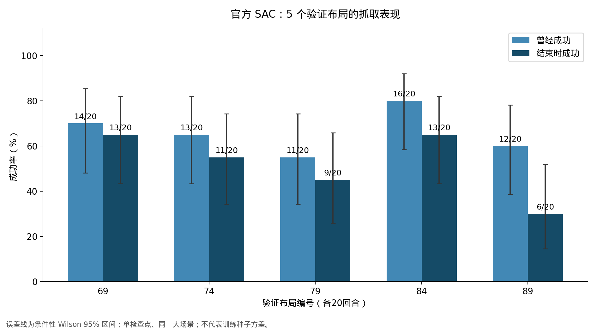
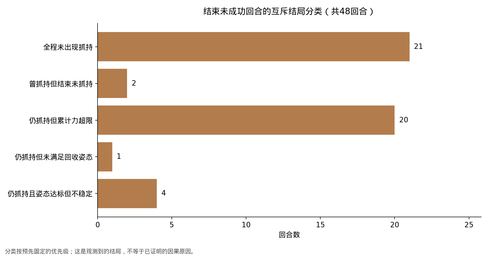
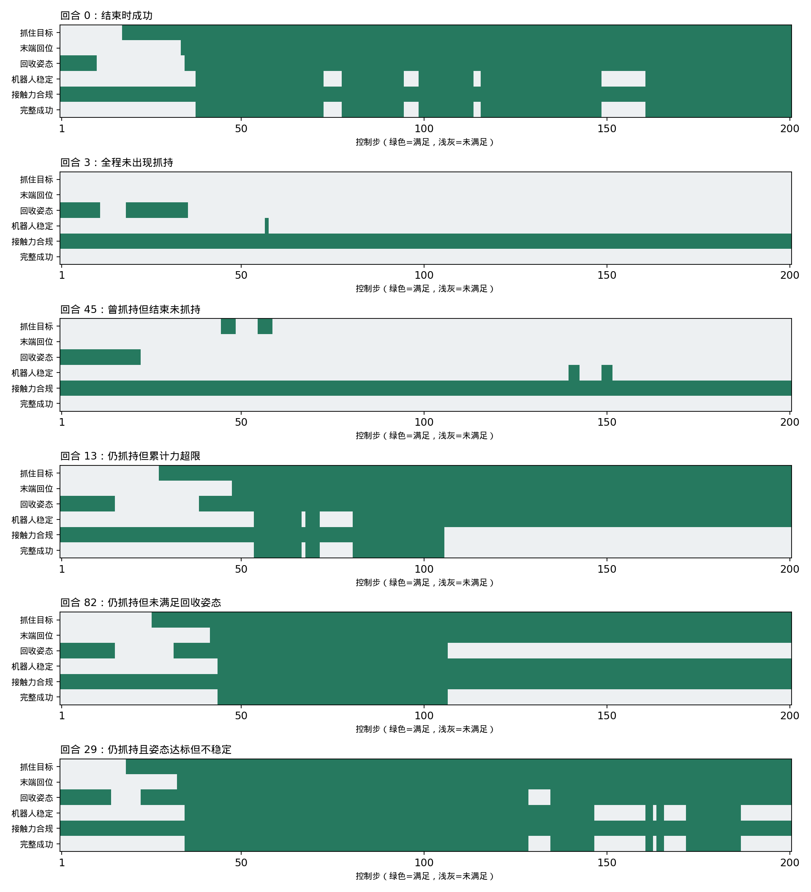

# ManiSkill-HAB：100回合跨布局评估与失败分析

评估对象：作者公开的 SAC all-object 检查点。任务：TidyHouse / Pick 抓取子任务。此次没有训练或修改策略，没有调用 LLM API。

## 实测结论

- 曾经成功：**66/100（66.0%）**。
- 结束时成功：**52/100（52.0%）**。
- 曾经出现抓持信号：79/100；出现预定义持续失去抓持事件：6/100。
- 至少一次累计接触力超过官方阈值：28/100。
- 全部100回合、20000个控制步的成功条件、终端统计和轨迹数值检查通过；100段视频均解码为201帧、512×512、20fps。

这是开发评估。5个家具布局均来自同一验证大场景sc3，不等于5套不同户型；不使用该结果宣称完整benchmark或最终测试泛化。单一官方检查点的结果不表示多次独立训练的稳定性。

原论文的子任务主要统计success once；本轮同时记录结束成功作为补充诊断。回合在首次成功后仍继续到200步，后续可能发生姿态变化或累计力超限。实际长任务技能链可能在满足条件后已切换技能，因此不能仅凭两项指标差值推断真实技能交接一定失败。

## 固定协议

从原验证集21个布局的排序索引等间隔取5个，编号69、74、79、84、89；每布局20回合。布局、种子、分类规则在预检前写入配置。原任务随机选择物体与初始化位置，没有按物体平衡，所有样本均保留。只改变布局和初始随机条件，不改动作、策略或任务成功阈值。

每回合200步；首次预检5回合、1000步，加修复后的连续重置预检10回合、2000步，共3000步单列，不计入下面100回合成绩。每次初始状态、布局、任务计划、生成索引、策略输出和逐步事件均保存。初始快照用于审计，尚未证明能精确恢复所有接触状态或完成严格配对。

首次正式运行在第22回合动作执行前发现重置回到默认布局并停止；已完成21回合布局正确。修复为每次重置明确传入固定布局，保持原环境每回合重建的行为。布局、种子、模型及评价条件均未变。续跑保留并跳过这21回合，只执行剩余79回合；前21回合文件哈希复核单独保存。错误日志、原源码、冻结配置及修复哈希记录全部保留。

策略SHA256：81f1f29b3af1ed4a3d3b502b515595dae852c4d842a1b1599203e46dee5f73e9。

## 布局结果

|布局|场景文件|曾经成功|结束时成功|结束成功率95%区间|
|---|---|---|---|---|
|69|v3_sc3_staging_00.scene_instance.json|14/20|13/20|43.3%–81.9%|
|74|v3_sc3_staging_05.scene_instance.json|13/20|11/20|34.2%–74.2%|
|79|v3_sc3_staging_10.scene_instance.json|11/20|9/20|25.8%–65.8%|
|84|v3_sc3_staging_15.scene_instance.json|16/20|13/20|43.3%–81.9%|
|89|v3_sc3_staging_20.scene_instance.json|12/20|6/20|14.5%–51.9%|

Wilson区间是给定检查点与选定布局下的描述性二项区间。相同布局内样本存在共享条件；本区间不量化训练随机性，也不保证未知场景泛化。各布局的物体与初始化构成可能不同，当前差异不能单独归因于布局难度。

## 回合结局与失败条件

曾经成功但结束失败共14回合，其中：仍抓持但累计力超限 9回合、仍抓持且姿态达标但不稳定 4回合、仍抓持但未满足回收姿态 1回合。这一统计尤其需要结合首次成功后的继续执行阶段理解。

|分类|回合数|
|---|---|
|结束时成功|52|
|全程未出现抓持|21|
|曾抓持但结束未抓持|2|
|仍抓持但累计力超限|20|
|仍抓持但未满足回收姿态|1|
|仍抓持且姿态达标但不稳定|4|

互斥分类优先级为：成功→全程未抓持→结束未抓持→仍抓持但力超限→仍抓持但回收姿态不满足→仍抓持且姿态达标但不稳定。它是描述结局的规则，不是因果诊断。下表保留所有失败回合末步未满足的条件，允许重复计数。

|未满足条件|失败回合数（可重叠）|
|---|---|
|抓持目标|23|
|末端回到目标位置|23|
|机器人回收姿态|20|
|机器人稳定|26|
|累计接触力限制|28|

持续失去抓持事件预定义为：至少3个连续控制步满足is_grasped，随后至少3个连续步不满足。它可能涉及放开、滑脱、碰撞或接触信号变化，不能直接称为物体掉落率。物体与末端位置、接触力和视频用于进一步判读。

## 示例事件时间线

绿色表示该步满足条件，灰色表示不满足。每幅对应预先规定选例规则选中的实际回合。

## 物体结果

|物体|回合数|曾经成功|结束时成功|
|---|---|---|---|
|002_master_chef_can|11|9|8|
|003_cracker_box|14|5|3|
|004_sugar_box|4|3|3|
|005_tomato_soup_can|7|6|3|
|007_tuna_fish_can|14|10|9|
|008_pudding_box|20|13|11|
|009_gelatin_box|13|9|5|
|010_potted_meat_can|8|4|4|
|024_bowl|9|7|6|

物体数量不平衡；样本少的物体只作描述，不据此给难度排名。

## 视频与算力

各类别选择编号最小的一条回合生成[示例合集](failure_analysis_examples.mp4)，时长60.30秒，保持原始20fps、不改变播放速度。它按结局类别展示，不按总体比例抽样。全部100个原始视频在对应episode目录中。

平均每回合步进与录像耗时12.65秒；策略网络平均推理耗时1.59ms、P95 2.78ms。后两个数只含策略前向及同步，不包含环境步进、渲染和录像，不应换算为整套系统实时控制频率。

仅GPU1运行本项目。按秒采样的GPU1整卡占用峰值4585MiB（含可能的其他进程）；GPU0最小空闲41239MiB。采样不能保证捕获瞬时峰值。

## 后续研究决策

本轮28个回合出现过力阈值超限，其中19个全程未达到完整成功条件。因此接触约束问题也出现在首次成功之前，值得与接近/抓取失败分别分析。这里描述事件共现，不证明改变单一奖励或加入世界模型就能解决。

**本轮14个曾经成功但结束失败的回合，末步均仍有抓持信号。** 因此不能把曾经成功率与结束成功率的差值直接当成掉落率。它们仍可能出现过中途接触变化，具体时序保存在事件记录中。

本轮最多的失败结局为**全程未出现抓持**，共21回合，占结束未成功回合的43.8%。这个占比描述当前样本，不代表因果贡献。

根据本轮结局分布，先挑选具有足够重复证据的问题，再制定世界模型实验。全程未抓持较多时，优先检查目标覆盖、接近与抓取探索；抓持后失败较多时，再检查稳定收臂与接触约束。仅靠这轮失败分类不能证明世界模型或风险模块优于其他方法。

本轮固定官方策略且没有算法对照；下一阶段应统一输入与数据预算建立HAB世界模型基线，风险训练使用独立训练样本，开发集用于选配置，最终测试另行保留。

## 文件和来源

[逐回合数据](episodes.csv) · [逐步数据](steps.csv) · [汇总JSON](summary.json) · [视频核查](video_validation.json) · [逐回合审计](audit.json)

环境、策略、任务定义来源：[ManiSkill-HAB官方项目](https://arth-shukla.github.io/mshab/)与[官方代码](https://github.com/arth-shukla/mshab)。本报告数据全部来自本次真实仿真运行。
