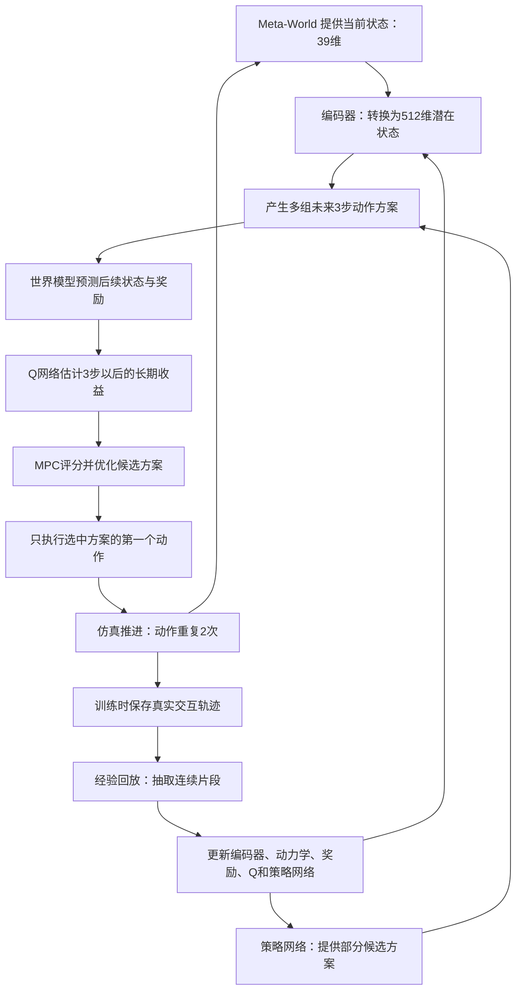

# Meta-World 实验：算法流程、训练评估与复现边界

更新：2026-09-09。本文对应已经完成的 **Meta-World Pick-Place V2、50 万环境步、最终末步成功 8/10** 实验及其演示视频。内容根据本项目固定版本源码和实际运行配置核对。

## 1. 复现的是哪篇论文？

**Nicklas Hansen, Hao Su, Xiaolong Wang. TD-MPC2: Scalable, Robust World Models for Continuous Control. ICLR 2024（Spotlight）。** 论文最早于 2023 年提交 arXiv，本轮参考 2024 年的 v2 版本和同期官方代码。论文信息可在 [作者项目页](https://www.tdmpc2.com/) 和 [arXiv](https://arxiv.org/abs/2310.16828v2) 核实；[点击下载论文 PDF](https://arxiv.org/pdf/2310.16828v2)。

Meta-World 是提供机械臂任务的仿真测试平台；TD-MPC2 是机器人学习与规划的方法。我们复现的是 TD-MPC2 在 Meta-World 中的单任务在线学习流程，并没有自行发明这套基本算法。

官方代码固定为 [`57158282b46ebc5c329c5be9cfe2b0094126d1ca`](https://github.com/nicklashansen/tdmpc2/tree/57158282b46ebc5c329c5be9cfe2b0094126d1ca)。本轮只运行 Pick-Place V2、一个训练种子和缩减后的训练预算，因此应称为 **“TD-MPC2 原方法的单任务、缩减预算复现”**，不能称为完整复现论文所有结果。

## 2. 机器人具体在做什么？

环境 ID 为 `pick-place-v2-goal-observable`，机器人为仿真的 Sawyer 机械臂。它需要把物体抓起并移到目标位置。目标可以在空中，因此演示不能简单理解成“必须松开夹爪并把物体放到桌面”。奖励和成功判断沿用固定版本环境。

算法输入是环境直接提供的 **39 维状态向量**，包含机器人、物体和目标相关信息；输出为 **4 维动作**，控制末端在三个方向的移动及夹爪开合。视频只用于展示，本轮模型并不读取视频画面，也没有用视觉模型识别物体。

本轮不需要调用 LLM API，不使用外部教师、公开预训练权重或专家示范数据。训练数据由机器人自己在仿真中交互产生，模型从随机权重开始学习。

## 3. 整个算法流程：先预测、再行动、再学习

可以把流程理解为：机器人看到当前状态，先在学到的模型里尝试几种动作方案，选出预计效果较好的方案，执行第一步，再看环境实际发生了什么。

图中的“预测”发生在神经网络内部，“执行”发生在 MuJoCo 仿真环境中。模型内部尝试几百条候选方案，不等于机器人真的执行了几百条方案；训练预算统计的是实际环境交互。

### 3.1 五个模块各负责什么？

| 模块 | 本轮结构或接口 | 它学什么、有什么用 |
|---|---|---|
| 编码器 | 39 维状态 → 512 维潜在表示 | 提取对控制有用的状态特征；维度变大不妨碍它成为内部表示 |
| 动力学模型 | 当前潜在状态 + 4 维动作 → 下一潜在状态 | 预测采取动作后情况怎样变化 |
| 奖励模型 | 潜在状态 + 动作 → 奖励分布 | 预测这个动作能得到多少环境奖励 |
| Q 价值网络 | 5 个 Q 网络组成的集成 | 估计当前动作及后续行为的长期收益，补足短期规划的视野 |
| 策略先验网络 | 潜在状态 → 动作分布 | 给规划器提供较好的候选动作，并用于价值计算；通过 Q 指导学习 |

这些模块使用官方约 5M 参数配置。动力学和状态表示采用原版 SimNorm；奖励和 Q 使用原版 two-hot 离散分布表示及相应损失。这些都是原方法已有设计。该模型不包含图像解码器，不负责生成未来视频；它预测对任务控制有用的潜在状态和收益。

策略先验不是“教师模型”。它与世界模型一起在本轮交互数据上学习，不是加载别人训练好的控制器。当前视频的控制方式为 `mpc=true`，确实经过世界模型预测和 MPC 规划。

### 3.2 MPC 每一次怎样选动作？

1. 编码当前状态；规划未来 **3 次动作决策**。沿用上一时刻规划均值的后两步，帮助本次搜索初始化。
2. 一轮共 **512 条候选动作序列**，其中 **24 条由策略先验产生**，其余从当前搜索分布采样。
3. 用动力学模型逐步预测三步后的潜在状态，用奖励模型估计三步奖励，再用 Q 网络估计三步之后的收益。
4. 选出收益最高的 **64 条精英序列**，根据收益进行指数加权，更新动作分布的均值与标准差。共迭代 **6 轮**。
5. 原版实现按权重从最终精英序列中抽取一条，执行它的第一个动作。下一时刻获取新的真实状态，再规划。不能把它描述成始终执行均值动作或固定的最高分动作。

候选序列的评分可简写为：

\[
\hat G=\hat r_0+\gamma\hat r_1+\gamma^2\hat r_2+\gamma^3\hat Q(z_3,\pi(z_3)),\qquad \gamma=0.95.
\]

这里的奖励和状态都由世界模型预测；最后一项提供长期价值，因此规划三步不意味着机器人只考虑三步以内的好处。Q 集成在本版本评分时随机选两个成员求平均，TD 学习目标则用目标 Q 中随机两个成员的较小值。

举例：当夹爪位于物体侧上方时，一些候选方案可能立即闭合夹爪，另一些先向物体靠近再闭合。模型根据预测奖励和长期价值给方案评分。以上只是说明机制的例子，程序没有写入“靠近→抓取→抬升”的人工阶段规则，也没有显式输出阶段标签。

## 4. 如何训练？

### 4.1 从随机探索到在线学习

1. 随机初始化全部可学习网络，清空经验回放。
2. 在环境中随机行动，收集最初约 1,000 次决策的数据。这里有一个源码细节：官方条件为 `_step > seed_steps` 才用规划动作，所以索引 0～1000 共 **1,001 次决策**仍为随机动作。`seed_steps=1000` 是门槛参数。
3. 在 `_step=1000` 时，用已完成回合的回放数据连续更新 **1,000 次**。原程序将这一过程打印为 “Pretraining agent on seed data”；这是原方法的随机初始经验学习，不是专家示范预训练或加载外部权重。
4. 此后用世界模型与 MPC 选择动作，每收集一次新的动作决策，执行一次学习更新。完整回合在下一回合边界加入回放，更新使用已进入回放的轨迹。
5. 反复“规划→仿真执行→记录经验→学习”，直到完成 **250,000 次决策，即 500,000 个原生训练环境步**。每回合 100 次决策，每次动作在环境中重复两次，奖励相加。

这就是在线训练：数据随着机器人在仿真中的行为不断产生，网络参数也随训练更新。没有真实机器人参与。“在线”与是否联网、是否调用 API 无关。

### 4.2 每次学习更新了什么？

每个批次从回放中抽取 256 个连续片段，每个片段包含 4 个状态、3 个动作和3个奖励。三步展开中的时间权重为 `rho=0.5`。

| 学习目标 | 通俗解释 | 本轮实现 |
|---|---|---|
| 潜在状态一致性 | 预测的下一状态表示应接近真实下一观测的编码结果 | 均方误差；目标编码停止梯度；多步展开 |
| 奖励预测 | 预测奖励应接近仿真给出的真实奖励 | two-hot 目标与交叉熵 |
| Q 价值学习 | 学习“眼前奖励 + 后面还能得到的收益” | TD 目标、目标 Q 集成、two-hot 交叉熵 |
| 策略学习 | 提高 Q 估计较好的动作的概率，同时保留一定探索能力 | Q 指导的策略目标及熵项；不模仿教师动作 |

世界模型与 Q 的总损失为 `20 × 一致性损失 + 0.1 × 奖励损失 + 0.1 × 价值损失`；策略使用单独的优化器。主学习率为 `3e-4`，编码器学习率乘以 `0.3`，梯度裁剪上限为 20，目标 Q 软更新系数为 `0.01`。这些数值沿用官方配置，未针对本轮成功结果重新调参。

## 5. 如何测试与评估？

训练在 0、10、20、30、40、50 万原生环境步分别暂停更新并评估，每轮 10 个完整回合。评估使用 `eval_mode=True`，不更新网络、不将评估轨迹加入训练回放。执行动作时不额外添加训练阶段的探索噪声，但原版规划器仍有候选采样、精英抽取等随机性；不能称为完全确定性测试。

主指标是 **回合最后一步的环境 `info['success']` 的平均值**。本适配器动作重复两次，返回第二个原生步的 info，因此该指标确实对应最后一个原生控制步。它不等同于“过程中曾成功过”，也不保证整个回合一直成功。

辅助指标为回合累计环境奖励的平均值。两次动作重复的奖励相加，再在回合内累加。训练环境步、评估步和 reset 内部的额外零动作步分开记录。

最终评估为 **8/10（80%）**，中途最好为 **9/10（90%）**。完整阶段表见 [50万步复现结果.md](50万步复现结果.md)。单种子、小样本结果暂时只支持“该任务上已学到有成功表现的基线”，不能支持稳定优于原论文或跨任务泛化的结论。

补录使用冻结最终权重和预先固定的种子 101、102、103，3 个回合均成功，零训练更新。这些回合不计入正式 8/10；演示页同时保留原评估失败视频。补录核验见 [演示说明.md](演示说明.md)。

## 6. 有没有我们自己的改进？

**这一轮没有加入新的算法模块，也没有得到“我们的方法优于 TD-MPC2”的结论。当前完成的是可运行、有记录、有成功演示的复现基线。**

| 内容 | 与原方法的关系 | 能否作为当前算法创新 |
|---|---|---|
| 世界模型、SimNorm、Q 集成、策略先验、MPC、在线学习和初始经验更新 | 使用原版实现 | 不能，这些属于论文已有方法 |
| Pick-Place V2、39 维状态、4 维动作、动作重复2次 | 沿用原版任务适配 | 不能 |
| 单任务、一个训练种子、50万原生环境步 | 缩减实验范围和预算 | 不能，属于实验范围设定 |
| 预算循环由 `<=` 改为 `<`，结束后显式评估 | 避免超出设定预算一次决策；不重写学习顺序 | 不能，属于计数及执行适配 |
| 用本地记录替代 W&B，保存轨迹、视频、权重与哈希 | 提高可追溯性和演示便利性 | 工程完善，不是学习算法创新 |
| Python/PyTorch/TorchRL 依赖兼容、MuJoCo 库路径和 GPU1 渲染绑定 | 使固定版本源码能在现有服务器运行 | 工程适配；需披露以说明并非逐字节相同的运行环境 |
| 早期 V3 实验的专家示范、BC及纠正数据流程 | 独立历史实验，本轮 V2 不使用 | 不能归因给本轮 80% 成功率，也不能凭跨版本成绩证明有效 |
| 课题名称中的接触感知、风险惩罚或末步稳定约束 | 本轮未加入 | 当前不能声称已经实现或验证 |

后续可以围绕“接触状态下预测误差如何影响规划”或“如何让成功状态保持到回合结束”设计改进，但目前只是待验证方向。应先固定同一环境版本、数据预算、训练种子和评估起点，比较原方法与改进方法，再做去掉新增模块的消融实验。多种子成功率、末步/曾成功差距和规划耗时可作为评价依据；新增方向的新颖性仍需要单独的文献核查。

向老师汇报时可以这样表述：**我们首先完成了 TD-MPC2 在 Meta-World Pick-Place V2 上的缩减预算基线复现，从随机权重训练 50 万环境步，单种子终点评估成功 8/10。当前未加入新的算法改进，后续研究将在同一基线上检验接触预测或成功保持方面的改进。**

## 7. 对照代码阅读

| 想了解的内容 | 本仓库文件 |
|---|---|
| 本轮任务、预算、记录、结束评估与完整性检查 | [runner.py](../runner.py) |
| 动作规划、模型更新、策略更新与 TD 目标 | [官方 tdmpc2.py](../upstream/tdmpc2/tdmpc2.py) |
| 五个网络模块和 Q 集成 | [官方 world_model.py](../upstream/tdmpc2/common/world_model.py) |
| 随机探索、初始更新和在线训练顺序 | [官方 online_trainer.py](../upstream/tdmpc2/trainer/online_trainer.py) |
| 动作重复、回合长度和状态环境 | [官方 metaworld.py](../upstream/tdmpc2/envs/metaworld.py) |
| 学习率、规划长度、样本数和损失系数 | [官方 config.yaml](../upstream/tdmpc2/config.yaml) |
| 复现范围、安装执行及依赖差异 | [本轮 README](../README.md) |

本说明只更新报告与展示页面，不修改模型权重、训练脚本、成功条件或已记录实验成绩。
